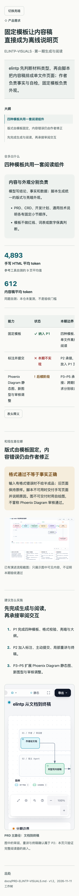

# M4 · 模板与阅读条件批次验收

- 计划：[ELINTP-VISUALS-P1](../ELINTP-VISUALS-P1.md)
- 更新：2026-11-11T15:24:39+08:00
- 状态：已完成；M2–M4 共用本记录的 V-2、V-3。R3 的 UI-03、UI-05 已按用户要求直接修复并经修复方浏览器复验，待独立复审；历轮处置见「UI 验收修复」。
- 验证基线：M2–M4 批次验收为 dirty@0b35470b；skills/elintp/scripts/、assets/、test/elintp/。评审修复为 dirty@39567336；skills/elintp/scripts/draft.mjs、test/elintp/render.test.js。

## 交付

四模板、全部组件、文字转义与 SVG 白名单、离线资源嵌入、亮暗切换、大纲、键盘焦点与打印样式已实现。V-3 暴露非法 progress 为 constructor 时继承属性造成异常：CLI 先复现 exit 1，再改为自有属性查询，恢复格式错误 exit 2。

## 偏差

用户澄清 Phoenix Diagram 是本仓工具，且 PRD 包含其修改；分期边界不代表用户禁止修改。安装缓存缺失不必向用户索要 release-dir，改从本仓固定工具链构建真实引擎。尚未发现需要修改 Phoenix 源码的缺陷。

V-2 B 的原示例 PHOENIX-DIAGRAM-P3 实际为部分完成，其 M3 引用的是合成测试品牌图，不是过程截图。改用本计划的已完成 M1 与当前 M4 记录，progress 按实际写 partial；截图采用本次真实 Chrome 走查画面。

## 已有验收

| 检查 ID/覆盖范围 | 命令或步骤 | 结果/必要证据 |
| --- | --- | --- |
| A-1 · 真实引擎与阅读器 | 源码 workspace 内 mise exec --no-deps -- mbx build --bin phoenix-diagram --locked --offline --message-format=json；实际二进制 finalize workflow 后 review-record | 构建 exit 0；sourceInputSha256 cff3ac1181c97817da9f745ad4dddaccc56a25d430cda9d824337a9d2ce710a8；四张 1440/2048 亮暗截图逐张实际查看，六节点、图例、分期卡片完整；finalize summary deliveryStatus=complete。临时原件 /tmp/elintp-p1/reader.html 与 reader.finalize-summary.json |
| V-2 · 固定外观资源 | 比较 A/A2 生成 HTML 中 style 与两段 script | 三段内容逐字节相同；Chrome 1440×900 对照 A/A2，页头、结论、大纲、指标和组件外观一致 |
| V-3 · 格式、安全、确定性 | node --test test/elintp/render.test.js | 4 pass，0 fail；包括非法 plan progress 回归 |
| V-2 · A 的窄屏初查 | Chrome DevTools 360×800，页面实际观察与 Console 度量 | viewport=360，document scrollWidth=360；表格320/360独立滚动；顶层资源无 http(s) 请求；顶层恰好两段脚本。全页截图见下方；交互结果见本次续验 |
| V-2 · 打印 | Chrome --headless=new --no-pdf-header-footer --print-to-pdf=/tmp/elintp-p1/A.pdf，独立临时 profile；pdftoppm 后逐页看图 | 四页正文、指标、状态、表头释义、完整截图、六节点阅读器及图例/分期卡片、图注与出处均在；控件隐藏。PDF 文本提取作辅助，不替代逐页观察 |

## 本次续验

屏幕解锁后恢复 Chrome 原生控制，直接操作本地 A/B/C/D/A2/D-ja 页面；未改运行代码，复用 V-3 与打印结果。

| V-2 步骤/范围 | 实际操作 | 结果 |
| --- | --- | --- |
| 1、4、5、8 · 四模板与阅读布局 | DevTools 360 CSS px 和 1440×900，查看首屏、正文、各小节与出处；点击 A/B/C 大纲并滚动 | 结论先于正文，顺序符合 slot；无页面级水平滚动，文字正常换行；大纲跳转并标记当前项，A 从截图小节滚到阅读器时标记随之更新；D 无大纲；C 繁体界面，D 英文，D-ja 英文且 Elements 中 html lang=ja |
| 3、6 · 主题与键盘 | 模拟系统 light/dark；Tab 到主题后 Enter，刷新；Tab/Enter 大纲、释义；360 下 Tab 到数据表后 Right | 系统偏好有效，手动暗色刷新后保留；正文、指标、表格、状态符号、自绘 SVG 可读；释义展开，表格独立横向移动且焦点框可见 |
| 7 · 禁用脚本 | DevTools Disable JavaScript 后重载 A，滚动查看正文、表格、释义、截图与阅读器 | 内容保留，释义直接显示，图和图例可见；恢复 Enable JavaScript 后继续检查 |
| 9、10 · 离线与注入 | Network 面板重载 A/D；Elements XPath //script、//img；查看 D 正文 | A 仅 file 本页与 data 内嵌图片/字体，D 仅本页一个请求，无外部请求；D 恰好两个模板 script、零 img；攻击标记按文字显示、无弹窗；Image missing 与路径可见。D-ja 同样核对 |
| 11 · 真实阅读器嵌入 | A 的 iframe 中 100%→125%，拖动图表，T 切换阅读器主题，复位；360 与桌面分别观察 | 平移、缩放、主题均有效；桌面复位后六节点、标签、两泳道、图例和分期卡片完整；360 的宽内容在 iframe 内滚动，宿主不横向溢出；截图完整按比例显示 |

## 评审修复

来源：[R1 代码评审](../ELINTP-VISUALS-P1.code-review.md)，SHA-256 `57b19b579e28d0f094af3b09483a9787a2dadcf10c63b4ed03dc0fa1e1662537`；所审 `0b35470b..55fe9a26`，修复目标是 main@39567336 的工作树，其间 `skills/elintp/` 与 `test/elintp/` 无变化。主记录里程碑为 M2（SVG 内联）。

| 问题 | 关联任务/检查 | 核实结论与证据 | 处置与修改落点 | 验证/后续 |
| --- | --- | --- | --- | --- |
| F-01 | M2 / V-3；§5.4 `svg:` 图 | 成立。修前公开入口渲染两张同名 `id` 的 SVG，exit 0，输出中 `shape`、`paint`、`tip`、`clip`、`t` 各出现两次；Chrome 中第二张显示第一张的红色方块、红色渐变与圆形标记，自己的裁切未生效。同一根因还会让图内 `id` 与页面锚点 `s<n>`、`main` 相撞 | 已修复并验证。`skills/elintp/scripts/draft.mjs` 的 `inlineSVG` 按图在文中的顺序加 `fig<n>-` 前缀，同步改写 `id`、`href`、`xlink:href`、各属性中的 `url(#…)`、`aria-labelledby`、`aria-describedby`；计划 §5.4 已同步。报告建议的「同一 SVG 内重复 ID 报格式错误」未采纳：隔离后单张图的表现与它独立打开时一致，不属于内联造成的缺陷，且计划 §5.5 与 D6 未列此类校验 | 下表三项通过；待 `review-code` 复审 |

| 检查 ID/覆盖范围 | 命令或步骤 | 结果/必要证据 |
| --- | --- | --- |
| V-3 / F-01 修前失败 | 新增用例「figures that reuse SVG ids keep their own definitions」后运行 `node --test test/elintp/render.test.js` | 修前该用例失败：全页 12 个 `id` 中只有 6 个不同值（含与页面 `s1` 相撞） |
| V-3 / F-01 与既有回归 | 修复后 `node --test test/elintp/render.test.js`，Node v25.2.1 | 5 pass，0 fail。新用例断言全页 `id` 唯一、每张图的 6 处本地引用都指向本图定义、两次输出逐字节相同；原 4 项不变 |
| F-01 真实浏览器 | 会话临时目录中两张同名 `id` 的 SVG（方块/三角形、红/绿渐变、圆形/箭头标记、不同裁切、`aria-labelledby`），`node skills/elintp/scripts/render.mjs dup.md after.html`，Chrome headless 900×1100 截图后实际查看 | exit 0，两次输出 `cmp` 相同。第一张仍是红色方块、红色渐变与圆形标记；第二张显示自己的绿色三角形与绿色渐变，并按自己的裁切在 x=200 处截断。第二张的箭头标记位于其裁切区外，画面上看不到，其引用隔离由 V-3 新用例证明 |

未重跑 V-1、V-2、V-4、V-5 与 §9.2 的其余收口检查：改动只在 `inlineSVG` 写出属性值的一处，段落、表格、图片、阅读器嵌入、模板资源与 skill 文案的代码均未变，原证据继续适用。单张 `svg:` 图的输出多了前缀；带前缀的渐变、标记、裁切与 `use` 引用正常解析已由上面第一张图的画面证明，跟随亮暗依赖的 `class` 与 `currentColor` 未被改写。

## UI 验收修复

### R1 → 修复 · 2026-11-11 14:05 +08:00

- 来源：[R1 报告](../ELINTP-VISUALS-P1.ui-review.md)（判定：需要修改；无停滞预警，无待裁定事项）；目标包 [ELINTP-VISUALS-P1.ui-target.md](../ELINTP-VISUALS-P1.ui-target.md) · 目标指纹 `b4f0cbfb2b40`
- 修复版本：UI修复 `873ecb3b`（被测基线 `fd55e648`；改动 `skills/elintp/assets/page.css`、`assets/page.js`、`scripts/draft.mjs`）
- 重构轮：无
- 用户方向：无

| 差距 | 核实 | 处置 | 改动落点 | 自检 |
| --- | --- | --- | --- | --- |
| UI-01 | 成立。修前用当前源码重新生成 U1，A4、12mm 边距打印：阅读器内宽 701px，落入它 720px 以下的窄屏布局，图按 720px 固定宽横滚（容器可视 667px，内容 744px），说明卡单列，内容高 1220px，而 `iframe` 固定高 760px，右侧节点与后两张卡被裁。把宽度放到 739px 时图能放下，内容高 854px，仍被 760px 截断 | 已修改待评审 | `draft.mjs`：`iframe` 外包 `div.reader-frame`。`page.css` 打印规则：`iframe` 按 840px 宽排版、高度取内容高度，按容器宽度的比例整体缩放到纸宽，去掉外框。`page.js`：`beforeprint` 时按 840px 宽并套用阅读器自己的打印样式量出内容高度（本例 788px） | 系统 dark 与 light 各打印一次，均 4 页：[dark 第 4 页](../ELINTP-VISUALS-P1.ui-captures/r1-apply/U1-print-dark-apply-4.png)、[light 第 4 页](../ELINTP-VISUALS-P1.ui-captures/r1-apply/U1-print-light-apply-4.png)。右侧「冻结候选」「在未见任务上独立确认」两个节点完整，图例七项，四张说明卡各四行、末行都在。打印后屏幕上的 `iframe` 仍是 840×738，放大按钮从 100% 变为 125% |
| UI-02 | 成立。修前系统 dark、未手选主题时打印，根背景为 `rgb(21, 33, 36)`，与报告实测一致；原因是暗色规则的选择器优先级高于打印规则里的 `:root` | 已修改待评审 | `page.css`：系统暗色规则限定在 `screen` 媒体，打印只剩亮色变量 | [dark 第 1 页](../ELINTP-VISUALS-P1.ui-captures/r1-apply/U1-print-dark-apply-1.png) 至第 4 页：页面、结论块、提醒块、指标、表格、状态均为亮底深字。系统 dark、系统 light、手选深色三种条件下打印媒体的根背景都是 `rgb(255, 255, 255)`，结论块 `rgb(241, 243, 242)`，主题按钮与大纲不显示 |
| UI-04 | 成立。[评审图](../ELINTP-VISUALS-P1.ui-captures/r1/U1-image-360-dark-a2.png) 中 1440×900 的截图被缩到 320px 宽，说明卡文字无法辨读 | 已修改待评审 | `draft.mjs`：图片外包可聚焦的 `div.image-scroll`。`page.css`：760px 及以下图片按原始尺寸显示，在该区域内横向滚动；打印仍缩到纸宽 | 360×800 dark：[默认](../ELINTP-VISUALS-P1.ui-captures/r1-apply/U1-image-360-dark-apply-01.png)、[键盘右移后](../ELINTP-VISUALS-P1.ui-captures/r1-apply/U1-image-360-dark-apply-02-keyboard-right.png)、[最右端](../ELINTP-VISUALS-P1.ui-captures/r1-apply/U1-image-360-dark-apply-03-end.png)。图片显示 1440×900，区域可视 320px、可滚 1440px；节点、图例与说明卡文字可辨。Tab 第 8 次到达该区域，按 12 次右方向键后内部滚到 480px，页面 `scrollWidth` 保持 360。禁用脚本时滚轮横移 500px 同样有效：[无脚本](../ELINTP-VISUALS-P1.ui-captures/r1-apply/U1-image-360-light-nojs-apply.png)。桌面 1440 下图片仍是 840×525，区域不可滚：[桌面全页](../ELINTP-VISUALS-P1.ui-captures/r1-apply/U1-default-1440-light-apply.png) |
| UI-03 | 成立。桌面 U3 跳到第二节时页面已滚到页尾，原逻辑在页尾一律标最后一节，所以第二节在 y≈110 却标了第四项 | 已修改待评审 | `page.js`：页尾时，够不到参考线的后续小节里，刚跳到的那一节为当前，否则取最后一节；离开页尾即恢复按位置判定。同一锚点再次点击也会重新标记 | U3 1440×900 light：键盘 Enter 激活第二项后，地址 `#s2`，第二节 y=110，当前项为第二项，见 [第二项](../ELINTP-VISUALS-P1.ui-captures/r1-apply/U3-outline-second-1440-light-apply-01.png)；滚回顶部当前项为第一项，再滚到页尾为第四项，见 [页尾](../ELINTP-VISUALS-P1.ui-captures/r1-apply/U3-outline-end-1440-light-apply-02.png)；再点第二项、第四项、第一项各自成为当前；带 `#s2` 直接打开也标第二项。本页「跳到第二节」与「滚到页尾」是同一个滚动位置，两张图的差别来自是否刚跳转。U3 360、U1 1440/360、U2 1440：点第二项标第二项，滚到页尾标最后一项，滚回顶部标第一项 |
| UI-05 | 现状属实：禁用脚本时宿主的主题按钮与释义按钮不显示、释义直接可见，内嵌阅读器右上角的「深色」按钮仍在（x=934–1009、y=112–156），不压图（图区从 y=196 起），见 [无脚本阅读器](../ELINTP-VISUALS-P1.ui-captures/r1-apply/U1-nojs-reader-1440-light-apply.png)。目标包 C7 引的两处来源里，计划 §6.2 写的是页头按钮默认 `hidden`，PRD WORK-N1/AC-3 只要求交互控件不遮挡内容，都没有约束阅读器内部的控件 | 待决定 | — | 需用户决定 C7 的「主题按钮隐藏」是否包括内嵌阅读器。包括的话要改 Phoenix Diagram 阅读器模板的无脚本表现并重新生成阅读器，属于工具改动，需另行授权；elintp 页面一侧无法在禁用脚本时改 `iframe` 内的文档 |

- 检查：`node --test test/elintp/render.test.js` 5 pass，0 fail。七份页面由 `node skills/elintp/scripts/render.mjs` 从当前源码用 R1 的输入重新生成；四模板 × 1440/360 共 14 个条件页面 `scrollWidth` 都等于视口宽；全程 0 条控制台消息、0 个页面错误、0 个失败请求。Playwright 1.59.1 / Chrome 157.0.8103.39，DPR 1；打印为 A4、12mm 边距的浏览器 PDF，Poppler 26.10.0 栅格化后逐页查看。
- 材料：截图在 [r1-apply](../ELINTP-VISUALS-P1.ui-captures/r1-apply/)，均为本次新采集，没有复用 R1 的图。页面、PDF、采集脚本与实测值在其 `logs/`（`apply-capture.cjs`、`apply-checks.json`）。截图与 `logs/` 按 `.gitignore` 不入库，只在本工作树可取。
- 影响范围：`page.css`、`page.js` 为四模板共用，打印颜色、大纲与图片区域的变化对四模板生效；阅读器打印只影响含 `reader:` 图的页面。屏幕上的版式未变。打印取证以 U1 为代表，其余模板未单独打印。
- 未完项：UI-05 待用户决定。禁用脚本同时打印时，阅读器用 760px 默认高度，本例图、图例与前两张说明卡完整，后两张说明卡的末行不显示；目标包分别要求无脚本与打印，未要求两者叠加。

### R2 → 修复 · 2026-11-11 14:40 +08:00

- 来源：[R2 报告](../ELINTP-VISUALS-P1.ui-review.r2.md)（判定：通过验收；无停滞预警；UI-05 待裁定）；目标包 [ELINTP-VISUALS-P1.ui-target.md](../ELINTP-VISUALS-P1.ui-target.md) · 目标指纹 `b4f0cbfb2b40`。报告已通过，本轮是对剩余 P2 的打磨
- 修复版本：UI修复 `256c43a3`（被测基线 `b90edbb7`；改动 `skills/elintp/assets/page.js`，计划 §6.2 大纲行同步）
- 重构轮：无
- 用户方向：无

| 差距 | 核实 | 处置 | 改动落点 | 自检 |
| --- | --- | --- | --- | --- |
| UI-03 | 成立。用 `b90edbb7` 的源码重新生成 U3（与 R2 所测页面逐字节相同），复走操作 70：1440×900 点第二项后当前项 `#s2`（第二节 y=110）；上滚 400 为 `#s1`；下滚 900 回到同一位置（scrollY 1449，已是页尾）变成 `#s4`。360×800 同样，第二节 y=35 时标 `#s4`。原因有两处：页尾在没有刚跳转时一律取末项；当前项只在小节进出观察带时重算，不随滚动位置变化。后者在 U2-done 上也能看到：点第二项后上滚 400，第二节已退到 y=746，仍标第二项 | 已修改待评审 | `page.js`：每次滚动按位置判定当前项，去掉 `IntersectionObserver`；页尾不再默认取末项，够不到参考线的小节只在刚跳到它、且页面还停在页尾时为当前 | U3 1440×900 与 360×800 复走操作 70，当前项依次为 `#s2`、`#s1`、`#s2`：[回到页尾](../ELINTP-VISUALS-P1.ui-captures/r2-apply/U3-outline-scroll-1440-light-apply-01.png) 左侧第二项高亮，右侧第二节在顶部（360 下大纲在页首，不在该屏内，以实测值为准）。只滚滚轮到页尾，U3 经过 `#s1`、`#s2`，原路滚回 `#s1`。点第四、一、三、四项各自成为当前，见 [第四项](../ELINTP-VISUALS-P1.ui-captures/r2-apply/U3-outline-last-1440-light-apply-02.png)；随后上滚再回页尾为 `#s2`。带 `#s4`、`#s3` 直接打开分别标第四、第三项。U1 两个视口滚轮经过 `#s1`、`#s2`、`#s3` 并原路返回；U2 六节逐一更新并原路返回。U2-done 后两节够不到参考线（页尾时 y=346、582；窄屏 294、495），滚轮全程 `#s1`，点第二、三项各自成为当前，离开页尾再回来为 `#s1` |
| UI-05 | 现状沿用 R2 的 [无脚本阅读器](../ELINTP-VISUALS-P1.ui-captures/r2/U1-nojs-reader-1440-light-a2.png) 与操作 67：宿主按钮隐藏，阅读器右上角「深色」按钮仍在。本次改动只在脚本的大纲部分，禁用脚本时不执行，该图仍适用，未重新采集 | 待决定 | — | 需用户决定 C7 的「主题按钮隐藏」是否包括内嵌阅读器；包括的话要改 Phoenix Diagram 阅读器模板并重新生成阅读器，属于工具改动，需另行授权 |

- 检查：`node --test test/elintp/render.test.js` 5 pass，0 fail。有大纲的四个页面（U1、U2、U2-done、U3）× 1440/360 共 8 个条件：页面 `scrollWidth` 等于视口宽，0 条控制台消息、0 个页面错误、0 个失败请求。Playwright 1.59.1 / Chrome 157.0.8103.39，DPR 1，系统亮色。
- 材料：截图两张在 [r2-apply](../ELINTP-VISUALS-P1.ui-captures/r2-apply/)，本次新采集。七份页面用 R1 的输入从修复后的源码重新生成，在其 `logs/pages/`；走查脚本与实测值为 `logs/outline-probe.cjs`、`outline-before.json`（修前）、`outline-after.json`（修后）。修前那次早于脚本里「带 `#s3` 直接打开」一步，无该项；修前页面核对后已删除。截图与 `logs/` 按 `.gitignore` 不入库，只在本工作树可取。
- 影响范围：`page.js` 为四模板共用，改动只在大纲部分，少于三个小节的页面在此之前已返回。主题、释义、打印、图片区域与无脚本表现的代码未变，R2 的对应证据继续适用，未重新采集。
- 取舍：同一个页尾位置不能既按阅读位置标第二项、又按「到底了」标末项。本次按 R1、R2 的验收口径取前者，所以短页面里够不到参考线的末尾小节（U3 第三、四节，U2-done 第二、三节）只能经大纲或锚点跳转成为当前，光靠滚动不会。
- 未完项：UI-05 待用户决定。

### R3 → 直接修复

- 来源：[R3 报告](../ELINTP-VISUALS-P1.ui-review.r3.md)，剩余 UI-03、UI-05；目标指纹 `b4f0cbfb2b40`，不重建基线。
- 用户方向：2026-11-11，用户要求“UI-03 和 UI-05 还是没解决啊？你看看好解决就现在解决掉，不单独apply了”。按现有 C7 隐藏无脚本阅读器主题按钮，不再等待其适用范围决定。
- 修复版本：提交号见计划完成记录 M4 行的 R3 UI修复；取证基线 `dirty@c1271161`。改动仅 `skills/elintp/assets/page.js`、`scripts/draft.mjs`、`references/draft-format.md` 及本计划/记录。无重构。

| 差距 | 根因与修改 | 处置 | 浏览器复验 |
| --- | --- | --- | --- |
| UI-03 | 页尾跳转目标会覆盖按阅读位置算出的当前项，滚开后临时状态清空，导致同位置不同结果。删除 jumped/页尾/哈希的特殊判定，当前项只随真实滚动位置更新；原生锚点跳转保留，计划 §6.2 同步 | 已修改待评审 | 修前 U3 桌面 scrollY=1449，点击末项为 #s4、回滚为 #s2；U2-done 也有同类差异。修后 U3 均为 #s2、U2-done 均为 #s1，两视口都一致。第二节直接锚点、上滚返回及长页相邻路径正常 |
| UI-05 | 阅读器 HTML 被原样嵌入，其主题按钮不依赖脚本即可出现。生成 srcdoc 时在 head 加 noscript 样式，仅在无脚本时隐藏 #btn-theme；不修改源阅读器或图工具 | 已修改待评审 | 修前宿主按钮隐藏但阅读器按钮可见；修后两者都隐藏。启用脚本时两者可见，阅读器实际 light→dark，图/图例/说明保留 |

- 最小检查：修前运行 [regression.cjs](../ELINTP-VISUALS-P1.ui-captures/r3-fix/logs/regression.cjs) 的 before 分支，UI-03 四个短页条件及 UI-05 无脚本失败；同一脚本 after 分支 10 个检查全部通过。另 8 个直接打开 #s2 的桌面/窄屏检查通过，0 pageerror，页面无横向溢出。Playwright 1.59.1 / Chrome 157.0.8103.39，DPR 1。
- `node --test test/elintp/render.test.js`：5 pass、0 fail；未增加浏览器依赖或运行全仓测试。SKILL.md/frontmatter 未修改，格式参考仅同步生成后的实际行为。
- 打印直接依赖复验：Chrome 修前/修后 PDF 各 4 页，pdftoppm 逐页栅格 SHA 全部相同。最初补查用固定像素高度/媒体切换后的框高断言，不能代表打印内容完整性，改为实际 PDF 前后对照；未为此修改打印实现。
- 取证：[capture.md](../ELINTP-VISUALS-P1.ui-captures/r3-fix/capture.md)，含新图、操作、版本与修前失败/修后通过路径。正常主题切换首帧处于动画中，a4 代表帧等待过渡结束，原图保留。图片和日志沿既有规则本地忽略。
- 影响范围：共用大纲影响带大纲页面；noscript 规则仅影响 reader 嵌入副本的禁用脚本状态。源阅读器 hash 与 R3 相同，未改 Phoenix 工具、目标包、历史评审或其他技能。
- 下一步：两项修复方复验通过，独立 UI 复审和代码复审由用户发起；本记录不替独立评审关闭差距或重打分。

## 未完项

M2–M4 无实施未完项；F-01 的修复待代码复审。M5 作者演练见 [M5 记录](M5.md)；M6 仍须完成干净副本每页的浏览器通读、主题、大纲及旧页打开。
