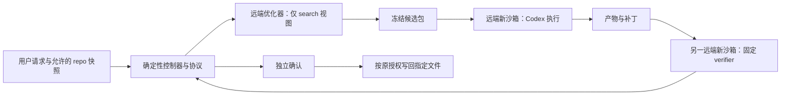

# Agent Instruction Evolution · AGENTS.md 与 Skills 自进化（远端隔离评测与有界搜索）

> **实施须知：直接依据本计划、仓库规则和当前代码实施或续做。** 先读下方「实施者定位」「实施进度」，核对工作树，再按相关正文与里程碑推进、验证、回写进度并按约定提交；使用 goal 执行时也遵循这些约定。
>
> **计划状态：Ready**
>
> 调查基线：2026-10-15 · `dirty@8e3d2811ffdc4366a38e917e842ff3344c142915`；事实以该 checkout 和本文列出的外部固定版本为准。
>
> 需求来源：用户需求，无 PRD。用户 2026-10-15 确认首期执行宿主为 Codex CLI；实施中明确改用所提供的 SSH 主机与现有 Codex 登录，统一模型 `gpt-6.1-sol`、thinking `high`，据此修订执行底座。
>
> 本期交付：**可在真实 coding 任务上改进 skill 与仓库指令的远端评测、搜索、确认和采用闭环，以及 `optimize-agents-md` skill。**
> **开发范围：本仓 agi-mode 的可选执行工具、相关流程与接口说明、新 skill、定向测试和文档；用户仓库仅按单次调用授权更新指定指令文件。**
> 本期独特职责：将现有自进化方法落实为可运行工具，区分 skill 收益、AGENTS 收益及组合影响；AGENTS 优化使用目标仓库自己的任务。
> **顶层排除：本机模型评测、自动修改用户全局配置、自动发布或合并、常驻后台服务、多宿主支持和自建云沙箱平台。**

## 实施者定位

执行本计划的 agent 是**资深软件工程师**，依据本计划、仓库规则和当前代码实施。

- **开发边界**：仅实施本计划明确纳入的系统与改动；范围外依赖按 §4 的契约、提供方与解除条件跟进，不代建、改造或部署。源码可访问、自有服务或同仓目录不扩大开发范围。外部缺口阻塞时回写影响与继续条件，推进不依赖它的已授权工作；就地修订偏差和委派不扩大范围，新增开发对象须有用户明确依据。fixture 只覆盖约定契约的必要行为，不能成为替代外部系统的产品，也不能冒充真实集成验收。
- **表达与源码**：报告用路径、需求/检查/里程碑 ID 定位，不复述计划。源码不放需求编号、agent 标记或规划元数据，注释解释必要原因；追溯放记录或提交说明。
- **编号与任务**：需求/约束/假设 ID 只在需求账本登记一次，上游 ID 保留原编号及来源；检查、里程碑、任务 ID 分别由验证表、里程碑表、按需内部任务表定义，正文、NFR 展开、映射和进度记录只引用。修订保留已有 ID，删除/拆分时同步引用；任务表若存在，按交付物、前置成果与检查 ID 推进，任务进展及证据写入所属里程碑记录，不另设任务状态表。
- **完成的定义**：本里程碑退出检查全部通过才能记完成；未运行、失败、环境缺失分别记缺口，不冒充通过。集中到阶段收口的终验由收口里程碑负责，通过前不宣称整期或跨期需求已验收。
- **角色验收**：上手与业务场景由 Agent 按 §9 指定的知识、资料及权限约束模拟，不能借内部源码或实现者补步骤；记录实际结果与卡点，不把模拟结果写成真人数据。有工具和权限的真实环境检查由 Agent 执行；真人公测指标按其指定阶段另验，不冒充本阶段已通过。
- **按计划路线实现**：计划已定的技术路线、接口、复用锚点和检查命令直接照做，不重新调研，也不为已定决策另起方案设计、比较或评判；计划没写的实现细节按最近的同构代码就地决定。调查只读本里程碑的改动落点及其直接调用方和依赖。只有代码事实推翻计划前提或路线走不通时才停下，就地修订对应正文并在记录写明偏差。
- **工作顺序**：需要行为测试的改动先红、再绿、再重构。按实际前置成果及检查推进，不等无关终验，数据、安全、发布及用户分期门不得绕过；稳定契约下可用 fixture 开发，不能替代真实集成。
- **验证节奏**：开发中和里程碑退出只跑 §9 中排在本里程碑的局部检查，即新增或改动行为的测试、直接受影响模块的已有测试和快速静态检查。全量测试、端到端、真实环境与界面走查、故障注入、评测等收口检查只在 §9 指定的阶段收口跑一次，同环境走查合并，不在中间里程碑或小改之后提前跑。已通过的证据只在它实际覆盖的代码、契约、配置、依赖或数据被改动时失效，失效就重跑那几项，不扩成全量。收口失败修复后重跑失败项和修复波及的局部检查；修复改动共享契约、公共入口、构建或依赖时，再重跑受影响的收口检查。调优、容量这类要反复尝试的工作，先用几分钟内能复测的缩小版本迭代，达标后再跑完整检查。
- **并行交付**：独立任务在收益超过委派/集成成本且工具可用时使用 subagents，模型默认继承。任务说明只给目标/ID、稳定契约、可写与禁改路径、运行资源和检查；共享文件单人负责，数据库、端口、浏览器等隔离或串行。子 agent 返回结果、路径、验证证据与缺口，默认不另写任务文档；主 agent 审查并集成验收。边界变化先回报，失败只阻塞依赖任务；结束对话前收集或停止仍在运行的任务。

## 实施进度（实施期持续更新）

本节是本计划跨对话恢复的**唯一汇总入口**，协议文字不随实施改写，实施期只更新「恢复快照」和「完成记录」。续做时先读仓库规则、本节、当前任务相关正文与依赖，再核对 `git status` 和相关 diff；记录与工作树不符时先查明原因，不凭记录覆盖用户改动，也不凭代码存在推断验收已通过。只有继续未完任务、核验前置验收、排错或审查时，才按链接读取对应记录的相关部分；不要默认加载全部记录或原始日志。

**回写时机**：里程碑完成后立即回写，再报告完成或提交；下游只需部分成果时，所需前置检查通过并在记录保存证据即可推进。实质进展后受阻、暂停、交接、发现偏差或结束对话时也保存成果与缺口；普通子任务切换不单独回写。

**一次回写**：主 agent 更新对应记录，再同步快照变化字段和完成记录一行，不重写无变化内容或追加流水。快照写当前任务、进展与下一步，命令及证据只进记录。首次回写删占位行，每个已记进展的里程碑恰好一行，状态仅「进行中 / 阻塞 / 已完成」；完成时移至已完成行末，最近完成取该行。更新时间带时区，摘要 1–2 句，记录填相对计划的链接（如 `[M1 记录](FEATURE.records/M1.md)`）。范围、决策、接口、数据、风险或退出条件有偏差时，就地修订对应正文，不追加勘误历史。

**独立记录**：按需建 `<计划名>.records/M<n>.md`，头部写计划链接、更新时区、状态及验证基线（commit SHA；未提交写 dirty@起始SHA 与关键改动路径）。正文只写交付行为/路径、必要偏差、未完项与继续动作；验收按 `检查 ID/覆盖范围 | 命令或步骤 | 结果/必要证据` 记录，共同环境和基线在头部写一次，有差异再单列。同一测试组可覆盖多条退出条件，须逐条可追溯；引用原证据与复用依据，不复制断言全文、成功日志或调试流水。证据是命令、结果和必要的少量输出，不为留证另写一次性脚本、哈希清单或大体量证据目录。未运行、失败、环境缺失明确区分；只有复杂交接、排错或证据需独立保存时才另建任务记录/日志/截图并链接。

**项目跟进索引**：仓库已登记状态台账，或存在仓根 `.xgent-ai/sdlc/protocol.md` 时（兼容已有 `docs/project-status/protocol.md`；两套并存未切换时先核对，不双写），上述回写完成后读取台账协议，只同步实际改变的当前状态和来源链接，必要时更新索引；默认直接更新本计划状态页，不因普通进展或来源版本变化另建事件，独立留存按仓内协议；未启用则跳过。复用已有计划 ID，只更新本次触及的范围，保留其他计划和各轮评审，不复制本节及里程碑记录；台账仅作项目索引，不替代本节的恢复快照。跨机器使用仓根相对路径与明确基线，未提交成果标明同步限制；登记失败说明缺口，不将原成果回退。

**提交**：在里程碑表后的「提交点」提交：里程碑较多时在标出的阶段收口后提交，全部里程碑完成后必须提交一次；仓库规则或用户对分支、提交信息、签名或是否由 agent 提交另有要求时从其要求。提交前先回写本次进度；提交点要求的检查就是本次覆盖的里程碑或阶段收口的检查，已通过且未失效的证据直接引用，不为提交重跑；只暂存本计划相关改动，不纳入、不回退他人改动，不跳过提交钩子。提交后把短 SHA 写入完成记录中本次覆盖的各里程碑行的「提交」列（代码评审修复的提交写作「修复」加短 SHA，UI 验收修复的提交写作「UI修复」加短 SHA，均追加在原 SHA 之后），再单独提交这次只改计划文件的更新，该提交不回填自己的 SHA。已完成但未到提交点的行写「待提交」；无法提交时写明原因并记入当前阻塞，不伪造 SHA。

**全部完成**：最后一个里程碑完成后，按上条完成最终提交并回写 SHA，确认每个已完成行的「提交」都有 SHA；恢复快照的「下一步」写代码评审。随后向用户报告完成，并提示下一步用 review-code 以本计划路径为参数评审本计划：它从完成记录找到要审的提交，并纳入未提交改动。评审由用户发起，实施中不自行启动评审或修复评审意见。

**回写后自查**：每次回写后直接核对以下条目：「当前进度 n/N」的 N 等于里程碑总数，n 只计状态为「已完成」的行；「最近完成」对应最后一条已完成记录，不按编号推算；链接指向已落盘文件；已完成行的「提交」是短 SHA 或「待提交」，全部完成时每行都有 SHA 且没有「待提交」。上述结构、计数与链接检查不证明验收真实通过。

### 恢复快照

- 最近更新：2026-10-16T05:27:43+08:00
- 当前进度：5/5 个里程碑完成
- 当前状态：已完成；M1–M5 验收与实现提交完成，独立确认 inconclusive、未采用候选
- 最近完成：M5 · 真实任务闭环与阶段收口
- 下一步：由用户按需发起代码评审；新任务/运行条件重新校准，不自动评审、发布或推送
- 当前阻塞：无；全部验收门已完成，失败与无赢家结果保留，所有本任务容器已清理
- 代码基线：a47bdd972185dcffbfc59c81af285edc2421c91d；原冻结试验基于 8e3d281/6944711，本次只回填计划 SHA 的提交不回填自己

### 完成记录

| Milestone | 状态 | 更新时间 | 简要记录 | 实现与验收记录 | 提交 |
| --- | --- | --- | --- | --- | --- |
| M1 | 已完成 | 2026-10-15T21:26:21+08:00 | 冻结协议/白名单字节包/自包含恢复；V-1/V-2 共 43 项通过，补兼容祖先及独立组约束 | [M1 记录](agent-instruction-evolution.records/M1.md) | a47bdd9 |
| M3 | 已完成 | 2026-10-15T21:26:21+08:00 | 有界搜索/恢复/一次确认、分组配对与报告；V-5 13 项、V-6 搜索 23 项及桥接局部 22 项通过 | [M3 记录](agent-instruction-evolution.records/M3.md) | a47bdd9 |
| M4 | 已完成 | 2026-10-15T21:26:21+08:00 | 新 skill、确认与未验证采用/CAS、接口同步；V-7 metadata 4 项、apply 11 项及集成清单通过 | [M4 记录](agent-instruction-evolution.records/M4.md) | a47bdd9 |
| M2 | 已完成 | 2026-10-16T00:21:41+08:00 | 实际模型/隔离、gold=1/empty=0、新源码捕获及测试篡改防护通过；固定公开模板已更新 | [M2 记录](agent-instruction-evolution.records/M2.md) | a47bdd9 |
| M5 | 已完成 | 2026-10-16T05:22:20+08:00 | V-8–V-11 全部完成，真实独立确认 inconclusive，未采用候选；全部资源已清理 | [M5 记录](agent-instruction-evolution.records/M5.md) | a47bdd9 |


## 0. 需求、范围与决策

### 0.1 需求与约束账本

| ID | 类型 | 来源 | 内容 | 设计/验收落点 | 状态 |
| --- | --- | --- | --- | --- | --- |
| R-1 | 功能 | 用户要求实现 AGENTS.md 和 skills 自进化 | 从任务反馈构造候选，比较、保留或撤回，独立确认后采用；允许未找到改进 | §5.4–§5.6；V-5、V-6、V-9 | 已确认 |
| R-2 | 功能 | 用户要求新增专用 skill | `optimize-agents-md` 专门优化用户仓库 AGENTS.md，保留原原则、事实和作用域 | §5.7；V-7、V-10 | 已确认 |
| R-3 | 功能 | 用户要求同模型比较、隔离 AGENTS 影响 | 固定模型与宿主；分别比较 skill、AGENTS 和组合，保留无目标 skill 对照 | §5.3；V-5、V-9 | 已确认 |
| R-4 | 功能 | 用户指出缺少真实任务、要求 GitHub task 集 | 首期接入固定版本 SWE-bench Pro V2，并支持同格式目标仓库任务；不以生成题替代真实终验 | §4、§5.2；V-4、V-9 | 已确认 |
| R-5 | 功能 | 用户确认 Codex CLI | 首期使用原生加载 AGENTS 的 Codex CLI，记录宿主与模型实际运行条件 | §2、§5.1；V-3、V-9 | 已确认 |
| C-1 | 隔离约束 | 用户明确 eval 不能在本地运行 | 优化器、被测 agent、判定执行均在远端新沙箱；本机仅做确定性编排、打包和报告 | §5.1；V-2、V-3、V-11 | 已确认 |
| C-2 | 原则与授权 | 根 AGENTS.md §7；现有技能演化约定 | 保留目标原有原则、立场、调用与授权策略；未解决的原则冲突不自动采用 | §0.6、§5.7；V-7、V-10 | 已确认 |
| C-3 | 兼容约束 | agi-mode/SKILL.md 与技能演化约定 | Eval 管判定，Hillclimb 管搜索；保留原判定词和 agi-mode 显式调用策略，可选工具不成为普通使用的强制依赖 | §0.6、§5.4；V-6、V-7 | 已确认 |
| C-4 | 证据约束 | 根 AGENTS.md；Eval/Hillclimb | 搜索与确认隔离；不把静态检查、已知题或同题重复当作未见泛化证据 | §3、§5.5；V-5、V-6、V-9 | 已确认 |
| C-5 | 仓库约束 | 根 AGENTS.md | `skills/` 是权威源码；接口同步维护；新增 skill 描述检查完整文本和前 100 字符，运行 npm test | §1.2、§9；V-7、V-8 | 已确认 |
| NFR-1 | 可恢复性 | 用户持续 loop 目标；Hillclimb | 原始尝试、失败、重试链和可恢复版本不被覆盖；断线不静默重复付费运行 | §3、§5.6；V-6、V-11 | 设计确定 |
| NFR-2 | 资源边界 | Hillclimb 资源与停止规则 | 每次运行必须给出有限候选数、trial 数、并发和截止时间；真实成本未知时标 null | §5.4、§7；V-1、V-6、V-11 | 设计确定 |
| NFR-3 | 可移植性 | 技能出仓使用；根 AGENTS.md | 工具随 agi-mode 分发；目标 repo、安装位置与任务命令运行时发现，不依赖本仓 local/ 或个人路径 | §1.2、§5.7；V-7、V-10 | 设计确定 |

### 0.2 决策表

| # | 决策点 | 选择 | 含义/影响 | 依据 |
| --- | --- | --- | --- | --- |
| D1 | 执行底座 | Harbor 0.24.0 + SSH 主机上的独立 Docker 容器，首期仅 Codex CLI | 按用户实施期选择复用现有远端主机及登录；Harbor 复用任务格式、Codex 安装/配置/轨迹；不保留 Modal 后端、不提供本机 fallback | R-4、R-5、C-1；§4；用户 2026-10-15 实施期明确选择 |
| D2 | 代码与分发位置 | Python 3.12+ 工具放在 agi-mode/scripts/evolution/ | 保持现有 npm 安装器零依赖；工具有独立锁文件，可随 skills 安装目录携带 | C-3、NFR-3；package.json 的 files 已包含 skills |
| D3 | 新 skill 边界 | `optimize-agents-md` 为仓库指令专用入口，依赖已安装 agi-mode 执行能力 | 不另建搜索规则；缺远端配置时可诊断、交候选，不冒称效果提升 | R-2、C-3；§5.7 |
| D4 | 题库策略 | Pro V2 为首个公共源；用户 AGENTS 绑定该 repo 的任务 | 不将仓库 A 的构建命令、目录规则套到仓库 B 上求分 | R-2、R-4；§5.2 |
| D5 | 状态与存储 | 单写入者、JSON 快照、逐次目录和 JSONL；每次远端执行由有界 runner 写收据，不建数据库、队列或 UI | 控制器保存逻辑执行 ID 与沙箱 ID，按远端命令收据恢复；不依赖控制器 finally 或私有命令句柄，未知提交窗口显式处理 | NFR-1、NFR-2；§2.2、§3、§5.6 |
| D6 | 采用策略 | search_best 与 confirmed_best 分开；写回采用前比较目标文件当前内容 | 搜索涨分不自动替换用户文件；已有明确写回授权沿用，不逐轮重新确认 | R-1、C-2；§5.5、§5.6 |
| D7 | 评价方法 | 任务成功为主指标，关键约束单列，按独立组配对估计差异 | 不照搬静态百点评分、固定题量或单次胜负阈值作为晋级标准 | C-4；现有 Eval 与评测记录模板 |

### 0.3 ADR-lite

#### ADR-1：复用远端任务执行框架

- 状态：Accepted（本计划技术路线）。
- 背景与驱动：C-1 要求离开本机执行，R-4 要求真实任务，NFR-1 要求完整证据与恢复。
- 决策依据：用户实施中明确选择所提供的 SSH 主机与现有 Codex 登录，替换原 Modal 运行方式；不再实现双后端。
- 决策：Harbor 0.24.0 保留为任务及 Codex 行为复用，remote.py 通过 SSH 操作远端 Docker，为每次执行创建独立容器。Pro V2 的固定任务、补丁捕获和新环境重判约定继续保留。
- 已核实前置：所给 SSH 主机为 macOS arm64，现有 Codex CLI 为 0.162.1，远端 Docker 29.5.2/Colima 服务可用；容器内的固定 Codex、登录与权限配置仍须 V-3 实测。主机 CLI 可用不等于容器内组合已验收。
- 正面后果：首期精力集中于归因、搜索与仓库指令优化。
- 负面/中性后果：需维护 Harbor/Codex 兼容锁与远端探针；上游支持某功能不等于本适配已验证该功能。
- 重新评估触发：固定版本无法支持所需隔离、轨迹或资源控制，且最小适配不能补足时，先保留已完成证据并修改本决策，不改用本机运行。

#### ADR-2：评测协议与优化对象分离

- 状态：Accepted（本计划技术路线）。
- 备选 A：一个 agent 同时改对象、挑题、判分并更新最佳版本。接入简单，但无法隔离确认材料和评分权。
- 备选 B：确定性控制器持有协议与完整结果，远端优化器仅看允许的 search 视图，执行与判定使用各自新环境。
- 决策：B。控制器不调用本机模型；普通文件读写不受本机全局 skill 的模型上下文影响。
- 正面后果：C-4 可以通过实际材料可见范围验收；方法版本与被优化对象版本独立留存。
- 负面/中性后果：增加候选包、反馈投影与收据校验，不能以共享 worktree 替代。
- 重新评估触发：增加分布式控制器或多人同时写同一搜索状态时另立并发设计，首期不预建服务。

### 0.4 职责与事实所有权

| 责任 | 本仓执行工具 | 远端平台与模型提供方 | 用户仓库与任务维护方 |
| --- | --- | --- | --- |
| 拥有 | 协议校验、有限调度、候选/运行快照、判定与证据、受控写回 | 沙箱能力、模型服务、平台凭证与计费事实 | 业务契约、原原则、任务起点、正常可读要求、验收标准与数据范围 |
| 不拥有 | 不改题求分、不发布、不代建云平台，不替用户决定原则 | 不决定候选是否优于基线 | 仓内文本不授予额外云权限，也不能改写本轮私有 grader |

### 0.5 明确不在本期

- 不运行本机 Codex、Claude Code 或本机 Docker 中的模型 eval；开发者本机可以运行无模型的确定性单元测试。
- 不改 bin/xgent-skills.js、根 AGENTS.md、全局安装目录和 Phoenix runtime；既有初始化入口继续保持“不覆盖已有文件”。
- 不建设管理界面、定时采集、任务平台、账号系统、模型训练或自动 GitHub PR/合并流程。
- 不批量接入全部 benchmark；PolyBench、FeatureBench、Live 等后续按真实需求增加。本期用户 repo 任务接口不依赖新增公共源适配器。
- 不声称公共题对底层模型未见；confirmation 只指未被本次搜索用于选择的任务。
- 不把单次成功或一次方法实践外推为普适自进化能力；方法间的等预算大规模比较另行开展。

### 0.6 参考集成 review checklist

本表是实施时逐项核对的集成清单。原原则、适用边界、调用和授权策略为基线；新增行为先更新本表，未解决的冲突先处理，不得在融合完成后补表。

| 目标文件/规则 | 当前行为 | 参考来源/段落 | 采纳、适配或拒绝 | 原则、边界、授权与接口影响 | 验证 |
| --- | --- | --- | --- | --- | --- |
| agi-mode/playbooks/eval.md；references/eval-protocol.md | 定义判定、隔离和记录，未绑定可运行远端工具 | Better Harness references/agent-customize/skill-eval.md，Stage 2；本仓 Eval §3 | 适配为可选远端执行入口，补收据与无效条件 | 不强制所有 Eval 使用该工具；不把缺工具转换为通过；协议字段向后兼容 | V-1、V-3、V-8 |
| agi-mode/playbooks/hillclimb.md | 持有唯一搜索状态、原判定词和最终确认 | Better Harness packages/harness/src/experiment/axis.ts；本仓 Hillclimb §2–§5 | 采纳配置差异核对，适配为 skill/AGENTS 内容差异；保留原状态 | 不引入另一套 accept/reject；联合变化只有预声明交叉对照才能估计各因素 | V-5、V-6、V-9 |
| agi-mode/references/skill-evolution.md | 定义内层候选、外层修评测及阶段所有者 | Better Harness README.zh-CN.md 的“已配置/已使用/改善结果”边界 | 采纳证据层次；增加工具路由，不复制五维或百点评分体系 | 已有 standalone agi-mode 使用方式不变，远端依赖只约束本执行模式 | V-7、V-8 |
| ★ optimize-agents-md/SKILL.md | 无专用仓库 AGENTS 优化入口；xgent-init 只初始化且不覆盖 | 本仓 authoring-a-skill.md；xgent-init/SKILL.md；eth-sri/agentbench README 的 NONE/LLM/HUMAN 条件 | 适配为 repo 专用优化，不改初始化入口，不复制论文生成策略 | 普通编码、单纯初始化和全局规则修改不触发；沿用会话已有授权，原则冲突不静默裁决 | V-7、V-10 |
| ★ evolution/remote.py 的 workspace、runner 与 grader | 无统一执行实现；Harbor 的常规收尾依赖当前控制器 | Pro V2 v2/README.md “locked protocol”；tooling/locked_codex.py；Harbor 0.24.0 codex.py 的 install/config/run；用户明确选择 SSH | 适配为 SSH 上的独立 Docker 容器、容器外远端 runner、超时捕获补丁与新容器重判；按 §2.2 保存命令收据并核对注入 | 保留原 verdict、材料隔离、确认与采用边界；仅按用户方向替换执行底座和认证来源，不引入常驻服务 | V-3、V-4、V-6、V-11 |
| ★ evolution/remote.py 的认证与工具权限 | 原计划仅模型 API 凭证，不复用登录态 | 用户明确授权远端现有 Codex 登录；Codex Configuration Reference 的 permissions 与 shell_environment_policy | 仅在远端控制面读取指定 auth.json，为模型角色创建临时认证副本；任务包、grader 与本机不接收凭证；工具文件权限明确 deny 认证和控制路径 | 授权仅限所指远端登录，不读取本机登录、不复制用户配置/skills/history；原凭证文件不改；V-3 不满足即停止 | V-2、V-3、V-11 |
| ★ evolution/remote.py 的隔离策略 | 本机存在全局 skill，独立目录不能证明隔离 | Better Harness compare/sandbox.ts；官方 Codex AGENTS/Skills 加载规则 | 拒绝继承本机 HOME 和 trusted-fixture 作为隔离保证；远端白名单注入 | 保留固定宿主内置资产并独立列明；发现清单外来源即停止该批次，不能降级本机 | V-2、V-3 |
| README；agi-mode 的 sdlc/what-next/scenarios/interface-design | 各处重述流程及技能接口 | 根 AGENTS.md 的接口同步规则 | 同步新 skill 的入口、缺依赖行为、执行条件和下一步命令 | 不扩大 agi-mode 自动调用权限，不改既有 SDLC verdict 或报告类型 | V-7、V-8 |

## 1. 当前事实与改动面

### 1.1 现状与缺口

- **已核实·足够**：agi-mode/playbooks/eval.md 分开发现与执行、规定实际隔离和最终确认；hillclimb.md 已有父版本、探索最佳、确认最佳、有限预算和失败保留规则。实现应执行这些规则。
- **已核实·缺口**：agi-mode/scripts/ 现有 check_evidence.py 校验证据材料，不负责远端运行、候选调度或配对统计；需新增执行工具，不能把现有检查结果称为性能提升。
- **已核实·足够**：package.json 的分发清单包含 skills；scripts/run-tests.mjs 已执行 Node、Python 和 skill metadata 检查。新工具放在 skill 内可随安装携带，独立 Python 依赖不注入现有 Node 安装器。
- **已核实·足够**：xgent-init/SKILL.md 明确已有文件保留，使用专用模板初始化；新优化能力不借初始化流程覆盖用户文件。
- **已核实·缺口**：local/spec-human-decision-eval/ 的 PROTOCOL.md 明确为一次性回放，未记录初轮精确加载 hash，共享文件系统仅靠任务约束；可提供开发线索，不是强隔离比较或 confirmation。
- **已核实·缺口**：Better Harness 的 compare/sandbox.ts 继承 HOME、标注网络未验证；可借用证据建模，不能复用为本计划的隔离实现。
- **外部已核实·契约足够**：Harbor 0.24.0 的发布包要求 Python >=3.12；Codex agent 支持 native config、skills 与 JSON 轨迹。其 `_build_register_skills_command()` 使用复制并容忍失败，本适配须校验实际文件，不能把配置成功当作注入成功。
- **外部已核实·恢复需适配**：Harbor 常规 run 的捕获/收尾依赖控制器；SSH 会话和 Docker exec 客户端本身同样不能充当持久命令结果。本方按 §2.2 在远端宿主运行有界 runner，通过容器 ID、独占启动、进程身份、真实退出与产物收据补齐恢复，不将 SSH 连通或容器存活视为命令完成。
- **实施期接入事实**：SSH、Codex 0.162.1 和 Docker 29.5.2/Colima 已实际接入独立容器。新登录已完成 gpt-6.1-sol/high 请求，隔离探针全部通过且内置运行资产已另行捕获。NodeBB/Vuls 失败保留，固定 Ansible 任务的 gold=1、empty=0 已通过；模型 SIGKILL 与受控导出中断已恢复同 ID。效果与剩余恢复子项尚无最终结论。

本仓行为来源：[Eval](../../skills/agi-mode/playbooks/eval.md)、[Hillclimb](../../skills/agi-mode/playbooks/hillclimb.md)、[评测记录](../../skills/agi-mode/references/eval-protocol.md)、[技能演化](../../skills/agi-mode/references/skill-evolution.md)、[证据检查脚本](../../skills/agi-mode/scripts/check_evidence.py)、[初始化入口](../../skills/xgent-init/SKILL.md)。

### 1.2 拓扑与文件清单

下列 ★ 路径为新增，其他路径只做本需求涉及的最小修订。

| 路径 | 交付与边界 |
| --- | --- |
| ★ skills/agi-mode/.npmignore、同目录脚本的 .gitignore | 排除本次测试生成的 Python 字节码和工具运行目录；不改变现有安装器 |
| ★ skills/agi-mode/scripts/evolution/pyproject.toml、uv.lock | `xgent-evolve` Python CLI；Harbor 固定 0.24.0，移除原 Modal 直接依赖；SSH 与远端 Docker 为运行前置，传递 Python 依赖随锁文件保存 |
| ★ 同目录 evolution.py | CLI、输入快照、单写入者搜索状态、恢复及应用；不做模型推理 |
| ★ 同目录 protocol.py | 输入和路径约束、来源/内容哈希、条件差异、search 视图导出与授权范围 |
| ★ 同目录 remote.py | Harbor Codex 子类、SSH/Docker 调用、注入核对、每次执行的远端 runner/收据、候选生成、独立验收及资源清理；runner 使用同文件的独立入口，不另建服务 |
| ★ 同目录 compare.py | 逐题聚合、配对差异、区间、guardrail 与原判定词映射 |
| ★ 同目录 tests/、examples/public-smoke.json | 无模型单元测试、受控故障替身、只含公开输入的远端烟测配置；不打包答案与确认材料 |
| ★ skills/agi-mode/references/remote-evolution.md | 工具安装、运行协议、证据边界、真实运行与恢复入口 |
| skills/agi-mode/SKILL.md、playbooks/eval.md、playbooks/hillclimb.md、references/eval-protocol.md、references/skill-evolution.md | 按当前阶段路由至可选工具；不复制完整工具手册 |
| ★ skills/optimize-agents-md/SKILL.md、references/repo-agents.md | 专用触发边界、目标仓规则优化与同 repo 任务选用；无需创建未使用的资源目录 |
| README.md；skills/agi-mode/playbooks/sdlc.md、playbooks/what-next.md、evals/scenarios.md、references/interface-design.md | 接口、流程交接与新行为场景同步；已有 agents/openai.yaml 如重述受影响入口，仅修改相应字段，不为旧 skill 补建该文件 |
| ★ test/evolution/metadata.test.js | 接口引用与新描述前 100 字符等轻量结构检查，纳入现有 npm test |
| ★ docs/agent-instruction-evolution.md | 用户安装与远端操作说明，链接权威协议，不复制 schema 和判定规则 |
| local/evolution/（运行时，已被 /local 忽略） | 本仓开发运行的私有输入、可恢复包和输出；出仓使用调用者指定 output 目录 |



## 2. 模块、接口与依赖

| 模块 | 调用者 | 接口与不变量 | 接缝 | 隐藏复杂度 | 依赖分类/适配器 | 测试面 |
| --- | --- | --- | --- | --- | --- | --- |
| evolution.py | agi-mode、新 skill、使用者 | validate / run / resume / apply；run 只走远端；不调用本机模型命令 | 同一 CLI；内部替身不暴露为 local backend | 快照、有限循环、恢复、写回冲突 | 文件系统；remote.py 是唯一外部调用点 | CLI 结果、快照与文件变化 |
| protocol.py | CLI、远端适配 | 未知字段和越界路径拒绝；以内容核对差异；每个 case 有信息截止点与来源组 | 公开 JSON 契约 | 导出规则、输入一致性、条件可归因性 | 进程内 | 坏配置、软链接、同源泄漏、元数据伪装 |
| remote.py | CLI | 仅 SSH 远端 Docker；每个 optimizer/trial/grader 独立容器；校验注入再执行；submit/query/cancel/export/cleanup 按 §2.2 接续同一命令 | Harbor Codex 行为、SSH 与 Docker CLI；远端宿主 runner 收据 | 断线、命令身份、超时、产物与独立清理 | 真正外部；测试 fake 仅用于无模型故障测试 | 实际远端探针、独立验收及进程退出恢复 |
| compare.py | CLI | 不读候选身份或改写原始结果；有效失败进入分母，infra_invalid 单列 | 逐次结果输入 | 分组配对、资源与证据门槛 | 标准库；不建通用统计框架 | 已知差异、全失败、平局、少样本、缺配对 |
| optimize-agents-md | 用户的 Codex 会话 | 仓库诊断→候选→远端评价→授权内采用；普通任务不升级为优化 | 已安装 agi-mode 的工具入口 | 层级作用域、政策保留、任务适配 | 已声明的兄弟 skill 依赖 | 自然请求、非目标请求、真实文件与运行结果 |

选择函数模块而非通用 provider/plugin 架构：只有一个远端实现；production 与故障 fake 的差异收在 remote.py 内。删除任一模块会将其拥有的实际规则散回调用者，故保留以上边界；不另建转发层。

### 2.1 CLI 契约

在本仓运行：

```bash
uv run --project skills/agi-mode/scripts/evolution xgent-evolve validate --spec local/evolution/job.json
uv run --project skills/agi-mode/scripts/evolution xgent-evolve run --spec local/evolution/job.json --output local/evolution/run-001
uv run --project skills/agi-mode/scripts/evolution xgent-evolve resume --run local/evolution/run-001
uv run --project skills/agi-mode/scripts/evolution xgent-evolve apply --run local/evolution/run-001 --repo /path/to/target-repo
```

出仓后将 `--project` 替换为实际发现的 agi-mode/scripts/evolution 安装目录；工具不查找本仓绝对路径。

- `validate`：不调用模型或创建云资源，输出已解析配置、允许导出的文件清单、条件差异和调用量上界；失败前不导出代码。
- `run`：输出目录必须不存在；创建唯一 run_id 并原子写快照后提交远端任务。smoke 模式在 M2 交付冻结输入→远端探针/校准→收据与产物导出→清理→report.json/report.md 的最小通路，不依赖 M3 的 compare/search。M3 扩展完整比较、搜索及 resume 调度；无有效改进也是正常完成。
- `resume`：核对协议、输入、宿主和模型条件；只接续已登记任务或未提交步骤，不创建隐式新实验。远端任务状态无法核实时返回恢复缺口，不能自动重复支付。
- `apply`：仅采用当前协议下 confirmation 通过的候选，检查原授权与文件 CAS；不提交、发布、安装到全局。客观事实修正的未验证写回须有单独明确授权，标记 unverified，不更新 confirmed_best。
- stdout 为简短 JSON 结果，长轨迹写输出目录；stderr 为无秘密值的诊断。退出码：0 为命令完成（包括 discard/inconclusive）；2 为配置/路径/授权范围不合法；3 为输入漂移、采用冲突或恢复未决；4 为远端环境/基础设施失败。采用结果须读取 verdict，不能用退出 0 代替优于基线。

### 2.2 远端执行与恢复桥接

采用**每次执行一个有界远端 runner，SSH 重连后读取收据**。Harbor 继续拥有 Codex 安装、原生配置和轨迹格式；宿主侧 runner 脱离 SSH 连接协调容器，容器内同文件的受控子进程监督器直接监督原命令、保留真实退出码并捕获产物，宿主侧再将收据及产物保存到远端执行目录。二者共用同一逻辑执行 ID，不调用模型 SDK、不创建第二种 agent runtime、不启动常驻服务。Docker exec 客户端退出不能代替原命令退出；容器有截止时间内的 keepalive。

`remote_task_id` 是控制器在提交前分配、对应一次 optimizer/trial/grader 执行的 UUID，**不是 Docker 容器 ID 或 SSH 进程句柄**。沿用字段 `sandbox_id` 保存 Docker 完整容器 ID；提交前另保存 ssh_target、remote_root 与唯一 sandbox_name，通过名称和所有权 labels 处理创建响应丢失。每个容器只承载该逻辑执行；命令内容 hash、runner 版本和输入 hash 均冻结。

| 操作（remote.py 内部接口） | 输入与输出 | 执行及失败语义 |
| --- | --- | --- |
| submit | 冻结执行配置、角色、输入包、幂等键、remote_task_id、截止时间 → RemoteExecution | 控制器先保存提交意图及资源名，SSH 调用 Docker 创建容器后立即保存 sandbox_id，再启动脱离 SSH 的远端 runner。runner 用独占标记认领该 ID，先写 starting 再启动一次原命令；相同 ID 已认领就只返回已有收据。创建或启动响应不明先 query，不靠重复 exec 猜测未运行 |
| query | 已登记身份 → 容器状态、命令阶段/进程身份、退出码、终止原因、产物清单及缺口 | SSH 重连原主机，按完整 ID 或原名称/所有权 labels 查询 Docker，读取收据并核对输入/命令 hash；核对容器内监督器及原命令身份，不把 Docker 客户端或容器存活当作命令状态。核对进程后重读阶段收据；身份不符、未知启动窗口或收据无法恢复时保留 unresolved，不重跑原命令 |
| cancel | 已登记身份、原因 → 当前收据/取消结果 | 控制器先保存取消意图，再写远端取消请求；runner 停止该次进程组，在有限宽限内 TERM/KILL 后进入捕获。取消不先销毁沙箱；runner 不响应且恢复窗口将尽时才强制终止，保留缺失产物、已耗成本和未决状态 |
| export | 已登记身份、captured 收据及产物清单 → 校验过的本地产物路径/hash | 只按清单下载到临时文件，校验后原子落盘，最后保存 export_status；中断后重复导出同一批字节，不重跑命令。缺文件/hash 不符保留缺口，不晋级 |
| cleanup | 已登记身份、导出确认或强制停止原因 → 资源终止结果 | 控制器或新恢复进程按 sandbox_id 终止并查询确认，再保存 cleanup_status；失败继续登记待清理。仅处理本 run 资源，不因终止成功推断命令或产物已成功 |

runner 将阶段、退出与产物收据原子写入远端宿主的执行专属控制目录，该目录不挂载到任务容器；容器无宿主 HOME、控制目录或 Docker socket 挂载。Codex 与工具使用容器内无提权权限的任务用户；认证副本只有模型驱动可读取，工具权限明确 deny，V-3 验证实际权限。runner 直接监督原命令，退出码不取日志 tee 的状态；stdout/stderr、Codex JSON/会话轨迹写文件，不依赖控制器保持输出流。状态为 prepared→starting→running→capturing→captured；running 记录 PID/进程组与启动身份，退出记录 exit_code/termination_reason，captured 最后发布完整产物清单（相对路径、大小、sha256）。export_status 与 cleanup_status 由控制器另记，不混入 Trial.status 或探索 verdict。

命令自然退出、超时或被取消后，**远端 runner** 负责停止遗留任务子进程、捕获允许的补丁（含新源码文件）、轨迹和退出收据；remote.py 将 Codex.run 的会话保全及临时认证/配置清理移交 runner，控制器断线不得提前执行该 finally 删除在用材料。收据与产物保存在远端执行目录，容器到期不自动视为产物丢失；恢复按预算窗口执行，历史证据保留和删除遵循运行者要求。控制器承担导出、创建独立 grader、聚合及资源清理；重连只执行文件查询、捕获/导出和资源操作，不用 `codex exec resume` 再调用模型。

## 3. 数据模型与生命周期

复用 references/eval-protocol.md 的字段与逐次记录，不建立竞争台账。所有新运行固定 schema_version=1；未知版本拒绝，旧原始证据不迁移改写。

| 对象 | 关键字段与约束 | 生命周期/权威来源 | 查询与索引 |
| --- | --- | --- | --- |
| JobSpec ★ | protocol_id；mode=smoke/compare/search；target kind=skill/agents；allowed_paths；source snapshots；task splits；固定 model/effort；guardrails；预算；采用规则 | 首次提交冻结，规范化 JSON 与所指内容共同计算哈希；模型、任务或 grader 变更必须新协议 | run 根的 protocol.json |
| InstructionBundle ★ | 相对路径、完整字节、sha256、文件模式、来源；baseline 与 candidate 不共用可写目录 | 包含必要未提交内容和明确允许的新文件；不含 .git 全历史、本机安装目录、凭证、会话；hash 不能代替包本身 | bundles/ 下按内容寻址 |
| Case ★ | case_id、group_id、repo_id、base snapshot、split、公开请求、可观察成功条件、grader_ref、信息截止点 | 任务/来源家族先分组再固定划分；agent 视图去掉答案与 grader；AGENTS 任务必须匹配目标 repo | 评测侧 manifests；优化器仅收 search 投影 |
| Trial ★ | 模板已有 run/attempt/case/group/repeat/candidate/config/status/retry_of 等字段；增加 remote_task_id、sandbox_id、instruction_receipt、patch hash、环境身份；关联下行远端执行记录 | 每次独立目录，原始失败不覆盖；status 仍为 ok/behavior_failure/infra_invalid；未知成本为 null | trials/ 与 results.jsonl；幂等键为 protocol+case+repeat+condition+attempt |
| RemoteExecution ★ | remote_task_id、role、幂等键、输入/命令/runner hash、ssh_target/remote_root/sandbox_name、sandbox_id、收据路径、phase、进程身份、exit_code、termination_reason、artifact_manifest、export_status、cleanup_status、截止时间 | optimizer/trial/grader 共用 §2.2；创建前预登记，启动前持久化容器 ID；远端宿主收据是命令阶段的依据，控制器保存已核对副本。starting/未知退出不能伪造为成功 | 各次目录的 remote.json；state.json 引用，容器名及 labels 可回查，Trial 的 ID 不变 |
| SearchState ★ | initial_baseline、search_best、confirmed_best、attempts、预算、下一步、冻结候选、confirmation 是否已暴露 | 单写入者；临时文件后原子替换；所有引用必须可恢复 | state.json；attempts.jsonl |
| Attempt ★ | method_version、optimizer model/effort、可见材料、父版本、机制假设、候选差异、运行、成本、verdict/reason | 保存真实尝试，不从最后候选反推过程；方法 hash 不以对象 hash 替代 | attempts/，保留负面结果 |
| Report ★ | 协议与版本、有效/无效计数、独立组数、配对差异、区间、关键回归、资源、证据、适用范围 | 只聚合现有记录；原始结果不被 renderer 重算；原始结果或协议不一致时拒绝报告采用 | report.json 为机器源，report.md 为人读视图 |
| FactCorrection ★ | schema_version=1、repo、明确授权、objective_facts_only、原文/候选/事实来源清单和候选 hash | 无任务或远端时保存已明确授权的客观事实修正；不是 JobSpec/模型实验，不借用 smoke 或 confirmation 资格 | correction.json 与同目录 blobs；apply 保持 unverified、confirmed_best=null |

本仓默认运行产物放 local/evolution/，用户仓库必须显式给出 output；私有输入、逐题答案和确认材料不进入技能分发或 Git。远端沙箱销毁前导出必要产物；导出缺失时保留缺口，不能晋级候选。删除运行目录由用户决定，工具只删除本次明确登记的远端资源，不自动清理历史证据。

### 3.1 JobSpec 必需设置

- `runtime`：provider 固定 ssh；显式填写 ssh_target、remote_root、远端 Docker 命令/版本和 codex_architecture。Codex 使用 Docker 内核原生 CPU 架构，任务镜像平台独立固定，不能在 QEMU 中用 amd64 Codex 建立用户命名空间。Harbor 0.24.0、Codex CLI 0.162.1 为锁定组合；安装器优先使用已有 Node/npm 获取固定官方平台包，避免重复安装 NVM；可在本任务 remote_root/tools 缓存安装产物，按完整清单核对后复制到新容器，不包含认证/配置/会话。可显式绑定已有 apparmor_profile、为模型驱动指定已有 model_proxy，不加载宿主策略、不修改系统代理，工具仍使用独立环境与网络限制。模型与 optimizer 统一使用用户指定的 `gpt-6.1-sol`、effort=high；工具和采样显式填写。条件改变开启新协议。认证仅在远端临时复制指定 auth.json，原文件不改、不传回本机、不进入输入包或证据。
- `optimizer`：方法内容 hash、实际模型和 effort；本次按用户方向与执行模型统一为 `gpt-6.1-sol`、high，角色成本仍独立记录。修改方法与修改对象是两个不同实验因素。
- `target.compatible_bases`：可选，调用者已核对指令适用性的历史起点白名单；工具验证它们是目标 commit 的祖先。AGENTS 默认只接受目标 base，历史任务仍限同一 repo，使用各自镜像代码，不接收目标当前源码覆盖；祖先关系不自动证明指令语义兼容。
- `budget`：max_candidates、max_trials（含校准、重试和最终确认）、max_parallel_trials、per_trial_timeout_sec、total_deadline_sec、recovery_window_sec 均为有限正数；无未声明无限重试。recovery_window_sec 在总时限内为停止、捕获、断线重连和导出预留，不额外延长预算；原命令截止时间不晚于 run 截止减该窗口，剩余时间不足则不启动。沙箱期限不超过 run 截止及平台上限，控制器消失也会到期；窗口耗尽仍缺产物时记未决/缺证，不承诺无限保留。
- `measurement`：主指标、权重、minimum_effect、quality_loss_limit（适用时）、confidence_level、minimum_groups、预定重复数、一次固定分析检查点与确认规则。
- `authority`：调用者已经授权的 repo、可导出材料、可改路径、远端主机与输出根、认证来源和是否允许写回；来自会话/配置的授权不由待测 repo 文本授予。缺写回授权不妨碍安全诊断与已授权评测。
- `protected_rules`：原原则/授权/作用域及必须保留的事实来源。可机械核对的原文块保留字节或定位；非机械语义由独立核对与反例场景覆盖，证据不清时禁止自动采用，不声称静态检查能证明语义等价。

mode 的必填项分开：smoke 只做远端探针、oracle/空补丁校准，可省略模型与 optimizer，不具备效果采用资格；compare 必须提供冻结条件包与模型，不生成候选；search 额外要求 optimizer 与有限候选预算。模型若只有可变别名，报告请求身份和提供方实际可观测身份及限制，交错回测基线；无法核对的后台版本不能冒称固定快照。

validate 先核算初始基线和一次最终确认的已知调用量；预算不足则拒绝启动。搜索只使用预留之外的预算，动态补测也不能挪用确认预算或突破总额；无改进候选时不为耗尽预算强行确认原版。

首次只支持质量提升与保质降成本两种既有目标。统计方法采用事前固定置信水平的按来源组配对 bootstrap；bootstrap 次数由工具固定并记录，10,000 次作为本实现决策，不冒称通用标准。有界质量差异同时计算独立组加权均值的 Hoeffding 界，采用区间取两者包络，避免三个组全胜时 bootstrap 退化为确定提升；原 bootstrap 区间另存。无上界的成本样本退化或缺成本时不提供采用区间。组数低于协议 minimum_groups、缺少完整配对或区间无法支持采用条件时为 inconclusive。一次 smoke 配置不提供效果采用资格。

## 4. 集成与契约

| 依赖/调用方 | 当前状态 | 行为级证据 | 本期处理 | 失败语义 |
| --- | --- | --- | --- | --- |
| Harbor 0.24.0 | 已核实契约足够，恢复桥接为本方增量，真实组合待 V-3 | 发布包 Python >=3.12；harbor.agents.installed.codex.Codex 的 install/run；native config/skills；_sdk_exec 只返回完成结果，Trial.run 的收尾依赖控制器 | 精确锁定；继承必要 agent 行为，覆盖注入并做文件/hash 检查；最终命令由 §2.2 runner 监督及捕获，不依赖默默成功的 cp 或本机 finally | 版本不符或注入收据不符，提交前失败或整批 invalid；恢复身份/结果不明为 unresolved |
| SSH 主机与远端 Docker | 用户已明确授权；只读接入与引擎检查通过，任务隔离未验收 | 主机 Codex 0.162.1、Docker Server 29.5.2、Colima/aarch64 Ubuntu 可用；已有远端 auth.json | 仅操作单次运行登记的独立容器/网络/执行目录；Harbor 提供固定 Codex 行为，远端 Docker 运行任务镜像；按 §2.2 收据恢复。M2 验证网络、挂载、工具权限、Linux/amd64 任务兼容与清理，不改造/重建宿主平台 | SSH、引擎或资源不可用为 infra_invalid，不切回本机；容器终态不代替命令结果 |
| Codex CLI | 已核实加载规则，远端目标版本待 V-3 | 官方 AGENTS guide 的全局→根→cwd 与 override；Skills 的 repo/user/admin/system 来源；non-interactive JSON 模式 | 首期固定 0.162.1；远端安装必须报告实际版本与二进制 hash；配置从显式白名单构造 | 不可用模型/版本明确失败，不自动换模型；条件漂移新协议 |
| Codex 远端登录与模型服务 | 用户已明确选择现有远端登录，实际模型访问未验证 | 官方模型页支持 `gpt-6.1-sol` 与 high；固定 CLI、远端 auth.json 存在；权限配置提供文件 deny 和工具环境过滤 | 统一模型 `gpt-6.1-sol`/high；仅远端控制面向模型角色临时提供指定登录，其他配置与历史不复制；grader 无认证材料。使用有限候选/trial/时间预算，订阅费用不可观测时 cost=null | 认证/启动失败为 infra_invalid，不自动换模型；运行内预算耗尽按 behavior_failure；错误脱敏，不把凭证写入日志 |
| SWE-bench Pro V2 | 已核实任务与协议足够 | 固定仓库 SHA `66f92766bba642462d4bbe5479e83f91f9211862`；v2/tasks 的 Harbor 包、公开镜像、verifier、gold、空补丁校验 | 按 SHA 取任务；镜像按 digest 解析冻结；首期只从该源选公开真实任务；不改验收求分 | gold 不过或空补丁误过，任务校准失败，整组不用于搜索 |
| 用户 repo task 包 | 约定本方输入契约，具体运行材料由调用者提供 | 与 Harbor 的 instruction、环境、tests 结构一致；另带 repo/base/group/split 元数据 | 检查与 target repo、起点和公开要求一致；缺环境时交诊断/候选，不能借公共其他 repo 的分数证明效果 | 材料不足为未执行或配置失败；不虚构测量 |
| 原 agi-mode/新 skill 的调用者 | 已核实已有所有者规则 | playbooks/eval.md、hillclimb.md；references/eval-protocol.md | 原有指导继续可用，显式持续进化目标才调用搜索；恢复已有授权和预算 | 缺可选执行能力时说明真实缺口，不启动替代本机评测 |

外部依赖所需就绪证据与最晚时点见 §11。上述运行凭证是使用工具的配置，不要求在写计划时创建云账号或花费模型预算。

外部来源：

- [Pro V2 固定版本协议](https://github.com/scaleapi/SWE-bench_Pro-os/blob/66f92766bba642462d4bbe5479e83f91f9211862/v2/README.md)：任务包、离线 agent 阶段、新沙箱重判与探针。本期借用机制，验收数据由本期实跑产生。
- [Harbor 0.24.0 发布元数据](https://pypi.org/pypi/harbor/0.24.0/json)：版本与 Python 条件；本次核对 wheel SHA-256 为 `23b7ba616a3aae4eff561ced5e2c51c7186f2981e53a770dea9c689d3969877c`。
- [Codex 权限与配置](https://learn.chatgpt.com/docs/config-file/config-reference)、[GPT-6.1 Sol](https://developers.openai.com/api/docs/models/gpt-6.1-sol)：用于明确文件 deny、工具环境白名单与 high 支持；当前文档不替代固定版本的远端实际探针。SSH/Docker 当前接入证据由 M2 实施记录保存。
- [官方 AGENTS 加载说明](https://learn.chatgpt.com/docs/agent-configuration/agents-md)、[Skills 来源](https://learn.chatgpt.com/docs/build-skills)、[非交互执行](https://learn.chatgpt.com/docs/non-interactive-mode)：用于指令链、隔离来源与运行记录，不把模型自述当作加载证据。
- [AGENTBench harness](https://github.com/eth-sri/agentbench)：仓库指令消融实验范式；不依赖其模型或结论决定本期候选胜负。

## 5. 核心机制

### 5.1 远端执行与隔离

1. 控制器校验 JobSpec、授权、预算和输出目录，冻结协议及可恢复输入；`validate` 和本机单元测试不启动任何 agent。
2. 导出 allowlist 中的 repo 内容与候选包。使用指定 base 的归档及必要 dirty patch/允许的新文件；不传宿主 .git 对象库、HOME、CODEX_HOME、.agents/.claude/.codex 安装缓存、auth、插件、MCP 配置、历史或 shell 快照。
3. 为 optimizer、每次 trial、每次 grader 各创建远端新沙箱。repo 自带的合法 skill 与指令不是一律删除：先枚举、冻结为固定背景，再按实验条件替换目标表面；所有隐藏目录纳入枚举。
4. 安装阶段可获取已锁定依赖和 agent，执行阶段采用远端网络策略仅允许所需模型入口。平台不支持该策略、镜像含后续修复历史或参考答案可读时，探针失败并停止该批次。
5. 从显式配置生成 Codex 运行文件，禁止自动导入宿主配置、skills、memory、plugins、MCP 和 resume 轨迹。容器用户 HOME 来自新环境，不传本机环境值；用户、管理员及宿主内置来源都核对。固定 Codex 自带系统资产单列为 runtime 背景，不冒称被清空。
6. 在 Codex 启动前生成文件来源/hash、挂载、环境变量名称白名单、二进制、模型请求与远端身份收据；不得记录密钥值。预期清单与实际不一致则不运行。可枚举来源、实际读取/调用证据和效果证据分开报告。
7. 正式执行使用相同提示、模型、effort、工具、预算和初始材料，经 §2.2 的已登记 runner 启动。由 runner 保留 JSON 事件、工具轨迹、首次结果和资源记录；到时停止原命令并在预留窗口捕获已产生补丁，超时不自动排除分母。
8. 只向另一新沙箱导出任务允许的交付补丁，应用后运行固定 verifier；不拷贝 agent 的临时环境或对 verifier 的改动。新建/未跟踪的合法源码文件也必须捕获；指令注入本身不混入交付代码补丁。
9. 产物落盘后按登记 ID 清理远端资源。清理失败单列，禁止删除不属于本 run 的资源；无完整证据不晋级。

认证材料仅由远端控制面从用户明确指定的远端 Codex 登录文件临时提供给模型驱动，不放到用户 repo、镜像层、普通任务环境或 grader，不传回本机。工具文件权限 deny 认证与控制路径，环境过滤移除凭证；这不构成对任意恶意代码的完备保密证明。原登录文件不改；临时副本由 runner 捕获会话后删除。若固定 Codex/Docker 环境无法满足该隔离契约，则拒绝该任务，不在本期自建凭证代理平台。

### 5.2 两种任务使用方式

**skill 评价**：固定公共任务集与各 repo 的背景指令，将同一目标 skill 的无目标/旧版/新版包注入对应试验。新版本必须在任务开始前冻结；按原策略测自然发现，另用显式加载测执行。任务要求是修复时不能用 review-only skill 代替执行，再以修复成功率评价评审质量。

**用户 AGENTS 评价**：每个 case 必须属于 target repo，并有与指令适用版本相容的起点、运行镜像和验收。来源为用户提供或已授权保全的真实任务；不能从未来结果倒推任务当时可知要求。无可运行任务时，诊断和候选仍可交付，效果为未验证；不启动无关公共 repo 对照。

`optimize-agents-md` 本身作为 skill 被评价时，可在多个公共 repo 上分别生成各自的候选 AGENTS，再检查后续任务结果；每个 repo 的文件不跨 repo 通用套用。首期验证该路径可运行，报告实际样本范围，不把它当作已完成普适方法比较。

### 5.3 条件与归因

定义 S∅ 为不提供目标 skill、S0/S1 为旧/新包；其他 skill 清单固定。Amin 是保留正常任务信息与不可变约束的最小契约，A0/A1 是旧/新仓库指令。Amin 的删减映射先登记，不能隐藏必要构建、验收或授权要求。

Amin 的比较只估计额外仓库指导的边际影响，不宣称测得整个 AGENTS 文件的无约束总效应；所有条件仍获得完成任务所需的公开要求。

| 要回答的问题 | 必需条件 | 结论边界 |
| --- | --- | --- |
| 新 skill 在当前环境是否改善 | S0/A0、S1/A0；首次建立 S∅/A0 | 收益只归于该固定背景下的 skill |
| 是否依赖当前 AGENTS | S0/Amin、S1/Amin，加上一行的两条件 | 比较两种背景下的 skill 差异，不直接将两个收益相加 |
| AGENTS 新版是否改善 | S固定/A0、S固定/A1；至少覆盖一种普通无目标 skill 任务 | 只归于该 repo/任务分布下的指令变化 |
| 两者是否协同或冲突 | S0/A0、S1/A0、S0/A1、S1/A1 | 预声明计算差中之差及分组回归；两因素一起改的单一 A/B 仅能评价组合 |

控制器比较实际内容 hash 与配置，不信任 lane 名称。只有目标表面可变；模型、任务、grader、其他工具或背景发生未声明变化，该对照 invalid。S∅ 必须同时移除目标正文、描述和旧副本，防止“无 skill”条件仍从其他入口读到它。

### 5.4 有界搜索

1. 校准任务与 verifier，完成 A/A 噪声检查，固定 search/confirmation 的来源组、协议和预算；完整确认清单由确定性评测侧持有，不上传优化器。
2. 首次基线同时保存 initial_baseline、search_best、confirmed_best 的明确身份；未确认的新对象不预填确认通过。
3. 远端优化器获得冻结的目标、主指标、最小收益与底线、固定的方法指导、目标源码、search 的输入/产物/失败证据与此前真实尝试；不获得 confirmation、其他条件身份映射或私有判定。输出一个机制假设、可证伪预期与最小补丁。
4. 校验修改范围、受保护规则和包完整性。禁止修改任务、grader、预算或把题目标识/参考答案写入 skill/AGENTS；不可机械确认的原则冲突标出并停止自动采用。
5. 对同题、同重复编号交错执行配对条件。运行有效性→底线→实际收益与区间→代价，依次判定；有效行为失败保留，基础设施无效与重试链单列。
6. 使用既有 keep/discard/inconclusive/invalid。keep 只更新 search_best；未定按事前补测规则处理，不能越过预算；invalid 先修运行条件，不能删除坏结果后当作未发生。
7. 两三轮有效尝试停滞时，按 Hillclimb 做不改候选的诊断；判定器问题走外层协议换版并重测，缺新信息则结束。不要求每轮都有修改或每次搜索找到赢家。
8. 所有候选、调度过的 trial、重试和确认都计入预算；并发初版默认 1，只有配置给出的有限并发才能增加，配对顺序和随机种子记录。总截止时间到达停止提交并取消已登记在途任务，保留已耗成本与未决状态。

优化器通过单独的 Harbor task 执行：由 remote.py 在评测侧生成公开 instruction、只含目标源码与 search 投影的工作区，以及校验候选产物的固定 verifier。它只输出 `proposal.json`（parent_hash、hypothesis、expected_effect、counterexample、changed_paths）和 `candidate.patch`；控制器在原父快照应用补丁、重新校验并计算 candidate_hash，不信任其自评或声明的哈希。方法指导包与被优化源码分别挂载，method_version 在整个 run 固定；即使 target 是 agi-mode，也不在同一 run 中换用候选指导来评价自己。

### 5.5 独立确认与采用门

冻结唯一候选及内容后，仅进行一次未用于选择的 confirmation；不能在这批题上挑多个版本。任务公开要求始终给执行者，隐藏的是后来的答案和评判材料。反馈一旦用于修改，该集合即暴露，后续确认需要新的独立材料。

- 质量目标：底线通过，配对质量差异区间下界超过协议 minimum_effect。
- 保质降成本：质量差异区间下界不低于负的 quality_loss_limit，成本收益区间下界超过预设收益；失败率与关键任务不能因廉价失败被掩盖。成本不可可靠测量时不判该目标达成。
- 样本、独立组、配对、运行条件或证据不足：inconclusive，不自动采用。“无显著下降”不能代替非劣性证据。
- 原则/授权/任务契约回归：discard，即使平均成功率更高。

最终状态另存为 not_run/passed/failed/inconclusive，并记录确认集暴露情况；不更改既有探索 verdict 的含义。确认失败恢复仍有效的 confirmed_best。首次没有已确认版本时保留原文件与未验证候选，不伪造可回退的成功版本。

### 5.6 恢复、应用与后续反馈

每次外部执行按 §2.2 先保存 remote_task_id、幂等键、冻结输入、资源名和提交意图；获得 sandbox_id 后在启动原命令前持久化。控制器中断不取消已登记 runner，也不触发 Harbor 收尾销毁未导出沙箱；有意停止走 cancel→捕获→export→cleanup。恢复只复用 hash 完全相同的协议、材料、命令和运行身份；更改条件创建新 run，保留旧 run 链接。

新进程的 `resume` 先 query 全部已登记执行，再按阶段推进：

- 明确尚未提交的 prepared 步骤可按原预算启动；创建响应丢失则按已保存的 SSH 主机/输出根/唯一容器名和所有权 labels 查询，查到后补记同一 sandbox_id。已尝试提交但无法确定结果、starting 无可确认命令身份、查询失败或身份漂移均保存 unresolved，不再启动原命令。
- running 且进程身份匹配时只等待/查询，由原 runner 继续运行和捕获；已进入 capturing 只接续捕获。runner 已消失时，只有确认任务进程组已停止才可执行幂等的 capture-only，保留可取回的部分产物；缺原退出收据则 exit_code 为 null、结果仍未决，不用补丁存在推断成功。
- captured 后仅重做缺失的导出并校验清单，随后从已冻结补丁接续尚未提交的独立 grader 与报告；grader 自身也按 RemoteExecution 登记，重复恢复不重复评分或追加结果。已导出只重试 cleanup。重连不新增原 agent/optimizer 的模型执行，结果按 remote_task_id 去重入账。
- 沙箱已失效且完整产物未导出时保存 unresolved/缺证与资源事实，不盲目重提；原 trial、预算和费用不抹除。重试须作为原协议允许的新 attempt 登记并计预算，不能冒充原执行恢复；恢复窗口和总截止到达后不启动新模型任务。

`apply` 先核对当前 repo 身份、允许路径和原始内容 hash。默认不改工作树；已授权的写回按同一冻结候选执行，不重新请求已有许可。单个 AGENTS 文件采用临时文件原子替换；skill 多文件先暂存全部新字节并建立恢复包，再逐文件比对并替换。失败只恢复仍等于本工具所写内容的文件，发现用户并发修改则停止并交恢复清单，不用 git reset 或整目录覆盖。

后续反馈仅来自后来已授权的真实任务或调用者显式提供的案例。关联目标实际版本和方法版本，将已见失败收入开发集；不扫描其他工作区会话、不自动启动监听或定时任务。

### 5.7 新 skill：optimize-agents-md

拟定接口：`$optimize-agents-md <repo 路径> [目标、文件范围、仅诊断或已授权任务包]`。

拟定描述：`用于用户要求诊断、精简或优化仓库 AGENTS.md；不用于普通编码、初始化或全局规则修改。基于仓库事实和该仓任务提出、评测并落实指令改进。`

保持默认可发现；自然请求必须明确针对仓库指令优化。无需给新 skill 添加禁止隐式调用的策略；agi-mode 既有显式策略保持不变。SKILL.md 的 compatibility 明示远端评价依赖 agi-mode 工具、Python/uv 和运行者配置。

流程：

1. 确认目标 repo、用户所指文件与授权；枚举根、子目录、override、fallback 和引用规则，核对实际生效链。被 override 遮蔽的 AGENTS 不冒称已生效，也不擅自修改遮蔽它的文件。
2. 从仓库命令、代码和现有规则建立事实与受保护原则清单。区分错误事实、重复、过时流程、作用域错误、冲突和规则存在却未执行；不把目标 repo 的习惯推广到用户全局。
3. 只读请求停在诊断。优化请求提出一个有机制依据的候选：修事实、去重、调整位置、收窄适用范围；可可靠交给现有工具的要求优先引用既有工具，新增脚本或其他文档须在原授权范围内。原原则与授权不能以效率为由删除。
4. 将候选与该 repo 的可重放任务交给统一工具。无本 repo 任务、无远端能力或数据导出未获授权时，明确缺口，交可审查候选；不借其他 repo 分数晋级。
5. 远端确认通过且已有写回授权时应用；未验证的客观事实修正按其明确授权处理并标注等级。交付差异、证据、成本、适用范围与恢复入口。

新 skill 不创建/镜像 CLAUDE.md，不改变 xgent-init 既有文件保留规则，不给普通任务附带长期搜索，不安装全局技能或更新用户全局 AGENTS。优化嵌套范围时使用该范围自己的任务，根规则改动须检查受影响子范围。

## 7. NFR、安全与运行保障

| ID | 基线/来源 | 目标或未知项 | 超限/失败行为 | 机制 | 验证 |
| --- | --- | --- | --- | --- | --- |
| NFR-1 | 原搜索规则要求原始证据与恢复点 | 断线后在预留窗口内接续原命令的观察、捕获、导出与清理；原失败和补救成本不消失 | 状态无法确认或产物已失效则暂停该运行并交恢复入口 | §2.2 的逻辑执行/沙箱身份、远端原子收据、独占启动、进程核对、产物清单与去重入账；原 trial 不覆盖 | V-6、V-11 |
| NFR-2 | 未提供固定金额预算 | 运行有有限次数和时间上界；不承诺平台之外的硬美元封顶 | 阈值到达停止提交/取消；未知费用不计零 | max_trials 含重试与确认，deadline、并发上界；美元为实测/估算分别报告 | V-1、V-6、V-11 |
| NFR-3 | 出仓安装位置与 repo 不固定 | 从实际安装路径可执行，源码或依赖不在时清晰失败 | 不回退本机模型、不使用 stale 安装副本冒充新源码 | 自包含工具目录、独立锁文件、路径与 hash 收据 | V-7、V-10 |

运行日志包含 run/trial/attempt/remote ID、状态、原因、计数和资源；只列凭证变量名称，不记录值。完整私有结果留在评测侧，优化器只接收规定投影。数据保留和销毁沿运行者已有要求，缺授权不导出私有 repo；用户给出的远端权限与文件范围跨轮复用，不重复索要。

## 8. 失败模式、发布与回滚

| 失败/触发 | 爆炸半径 | 数据后果 | 用户表现/降级 | 检测 | 恢复/补偿 | 验证 |
| --- | --- | --- | --- | --- | --- | --- |
| 注入了清单外全局指令/skill | 当前配置批次 | 对照污染，无法归因 | 停止批次，不出采用结论 | 实际来源/hash、挂载与远端探针不符 | 重建沙箱/新 run，不复用污染结果 | V-2、V-3 |
| 候选改了 grader 或读到参考答案 | 当前协议/已暴露样本 | 评分不可信、确认集失效 | invalid 并注明暴露 | 修改范围校验、可见性探针、独立重判 | 固定/修复评测；新协议重测，已暴露题归开发集 | V-2、V-4、V-6 |
| 原命令启动后控制器退出或创建响应丢失 | 当前在途任务 | 可能重复费用、缺退出或产物证据 | 按 §5.6 接续原执行；身份/产物不可确认时 unresolved | RemoteExecution、资源名/ID、runner 阶段/进程身份与产物清单对账；沙箱状态单列 | 原 runner 捕获，新进程只查询/导出/清理；不重提模型命令，不依赖旧控制器 finally | V-6、V-11 |
| Agent 超时、崩溃或超预算 | 单次 trial | 部分补丁、资源已耗 | behavior_failure，仍进分母 | 原生退出、超时事件、轨迹 | 捕获部分产物，按原协议而非择优重跑 | V-4、V-6、V-11 |
| 采用时用户已修改同一路径 | 目标 repo 的允许文件 | 可能覆盖用户修改 | conflict，原文件不改 | 逐文件内容 CAS | 回到新基线重新评测；不自动合并被测对象 | V-7 |
| 指令删除原原则或越出授权 | 候选及受影响任务 | 行为收益违背用户要求 | discard/待裁定，不自动写回 | protected_rules、独立差异核对与反例任务 | 恢复有效确认版或原文件 | V-7、V-10 |
| 远端产物导出或清理失败 | 当前 run | 缺证据或残留计费资源 | partial evidence / cleanup pending | 产物清单与资源 ID 检查 | 重试已知对象的导出/销毁；不得标确认通过 | V-11 |

发布顺序：先落协议/工具与锁文件，再通过远端隔离风险门，再开放搜索与新 skill 入口，最后完成真实任务终验。缺远端验收的版本不得宣称已支持可靠自进化。

工具回滚是恢复原指导路由与工具版本，不删历史运行；候选采用回滚只作用于该 run 拥有的允许文件。安装、提交和发布按原任务授权，不把本计划的开发最终提交等同于发布新 skill。

## 9. 验证

### 9.1 行为与接口验证

以下命令中的新目录和命令均为本计划交付。`npm test` 和 Python 单元测试均不调用模型、不启动本机评测；所有带模型的验证必须走 `run` 的 SSH 远端独立容器。真实运行统一 `gpt-6.1-sol`/high，远端认证来源与有限预算由运行配置声明，不能把占位主机或模型提交为实际运行。

| 检查 ID | 需求/验收行与可观察结果 | 命令/入口与环境 | 执行时点 |
| --- | --- | --- | --- |
| V-1 | R-1、R-3、NFR-2：非法 schema、无限预算、条件漂移和 confirmation 泄漏拒绝；validate 不提交远端任务 | `uv run --project skills/agi-mode/scripts/evolution python -m unittest discover -s skills/agi-mode/scripts/evolution/tests -p test_protocol.py` | M1 局部 |
| V-2 | C-1、C-4：只打包 allowlist，含必要 dirty 内容；软链接越界、宿主配置、Git 后续对象和答案不进入 agent 包 | 同一 unittest 入口，`-p test_bundles.py`；临时 fixture 只做文件操作，不运行 agent | M1 局部，M2 输入前置 |
| V-3 | R-5、C-1：实际远端隔离、固定版本、可枚举来源和预期指令 hash 一致；无其他 skill、记忆、宿主 HOME、控制目录或 Docker socket 挂载；工具不能读取认证副本、环境凭证或写 runner 收据；禁止 local fallback | `xgent-evolve run --spec local/evolution/isolation-probe.json --output local/evolution/isolation-probe`，经 §2.1 的 uv 入口；M2 最小 smoke/run，SSH 上真实独立 Docker 容器；含工具权限、读取/网络/后续历史及登录配置探针 | M2 独立隔离风险门 |
| V-4 | R-4：选定真实公共任务在独立验收环境中 gold 通过、空补丁失败；runner 捕获新源码文件，篡改测试不影响 grader；收据、导出与清理结果可读 | `xgent-evolve run --spec local/evolution/public-smoke.json --output local/evolution/public-smoke`；M2 的最小 smoke/run，spec 从 examples 解析生成，固定 Pro SHA，模式 smoke，无优化模型，不依赖 compare/search/resume | M2 真实任务校准门 |
| V-5 | R-3、C-4：按组配对，不把重复当独立任务；已知赢/输、平局、少组数、缺成本、交互效应与非劣性均正确判定 | unittest 入口，`-p test_compare.py`；用预先给定结果，不伪装真实模型效果 | M3 局部 |
| V-6 | R-1、C-3、NFR-1、NFR-2：候选有界、状态词不变、确认一次、无赢家正常结束；§2.2/§5.6 各阶段恢复、启动窗口不明、重复导出/清理和去重入账正确；中断/重试不覆盖失败、不越预算 | unittest 入口，`-p test_search.py`；remote fake 注入已知故障，不算远端验收 | M3 局部 |
| V-7 | R-2、C-2、C-3、C-5、NFR-3：新描述/接口/依赖与引用完整；apply 只改允许路径、CAS 冲突不覆盖、仅事实修正保持未验证标记 | `node --test test/evolution/metadata.test.js`；unittest 入口 `-p test_apply.py`；逐项对照 §0.6 diff | M4 局部 |
| V-8 | C-5：现有 Node/Python/metadata 全量门与新增工具测试通过；原有入口和调用策略保持 | `npm test`；`uv run --project skills/agi-mode/scripts/evolution python -m unittest discover -s skills/agi-mode/scripts/evolution/tests`；`git diff --check` | M5 阶段收口 |
| V-9 | R-1、R-3、R-4：真实任务完成 A/A、S∅/S0/S1 与 AGENTS 对照，冻结候选后独立确认；报告实际效果/未知，不要求强造涨分 | `xgent-evolve run --spec local/evolution/acceptance-skill.json --output local/evolution/acceptance-skill` 及 `acceptance-agents.json`；一个固定远端部署；spec 和所有运行数先经 validate | M5 阶段收口 |
| V-10 | R-2、C-2、NFR-3：干净安装下以真实自然请求使用新 skill；仅诊断不改文件、缺任务不称提升、有任务走确认与 CAS；初始化/普通编码请求不误触发 | 同一远端验收部署，角色仅获公开安装说明、目标 repo、允许操作和本场景材料；记录实际技能目录、调用、差异与阻塞，禁用父会话/全局注入 | M5 阶段收口 |
| V-11 | C-1、NFR-1、NFR-2：原 Codex 命令已启动时直接终止本机控制器进程，远端 runner 继续；新进程在窗口内恢复同一 remote_task_id/sandbox_id，识别运行/完成状态，取回原退出收据、结果及补丁并清理；模型执行数不增加，重复 resume 不重复入账；另覆盖超时/取消、导出中断和无法确认时 unresolved，grader 不继承 agent 临时状态 | 同一远端验收部署，确认 running 收据后向控制器发送 SIGKILL，再以全新进程执行 `resume --run local/evolution/recovery-acceptance`；对照启动收据、模型调用与资源记录；只注入有限受控任务，停止后不再提交 | M5 阶段收口 |

### 9.2 真实验收边界

M2 只校准隔离和验收链，不执行完整模型基准。M5 在同一固定环境合并真实主路径、恢复与新 skill 走查；已通过且不受改动影响的 M2 证据引用复用。配置/镜像/宿主或注入机制有变化时重验受影响的风险门。

首期 skill 试点选择与真实 bugfix 请求匹配的 debugging；候选保留其“先查明根因”立场。AGENTS 试点在选定 Pro repo 中构造该 repo 专属 A0/A1，连同普通请求和固定 skill 条件检查，不把本仓 AGENTS 套到 Pro repo。

接入烟测的 NodeBB/Vuls 失败保留，最终使用固定 Ansible 任务完成校准并作为公开模板；这些已见题仅用于开发和 search。效果验收另由控制器先按来源组固定 search/confirmation；确认材料不进入优化器。题量、组数、重复数、实际调用与无效数都据实报告。证据不足允许 inconclusive，平台开发完成不等于已证明候选普遍更强。

## 10. 里程碑与验收安排

| # | 里程碑 | 前置依赖 | 内容与并行边界 | 验证/退出条件 |
| --- | --- | --- | --- | --- |
| M1 | 冻结协议与可恢复输入 | 无 | ★ protocol.py、evolution.py 的 validate/快照、pyproject/uv.lock、tests 的协议与打包；沿用 eval-protocol.md 字段，采用现有 check_evidence.py 的标准库 CLI/明确失败范式，冻结 §2.2/§3 的 RemoteExecution、收据与恢复窗口；协议与共享数据单人负责 | V-1、V-2；回写「实施进度」 |
| M2 | 远端执行与最小 smoke/run 可运行 | M1 包契约与 V-2；SSH/Docker、明确授权的远端登录及有限配置按 §4 就绪 | ★ remote.py 的 submit/query/cancel/export/cleanup、宿主侧远端 runner 与收据；★ evolution.py 的 smoke 模式 run 接线及最小报告；★ examples/public-smoke.json。复用固定 Harbor 的安装/配置/轨迹与 Pro 的补丁捕获/新容器重判；连接 M1 包→远端探针/校准→收据与产物→清理，满足 V-3/V-4 全部入口，不依赖 M3。按用户选择更新 M1 的 SSH 授权/身份字段并复测 V-1/V-2；先通过隔离门再开模型试验，共享 evolution.py 单人集成 | V-3、V-4；回写「实施进度」 |
| M3 | 有界自进化与可信比较 | M1 协议；M2 稳定远端调用接口及 smoke/run；真实试验须已过 V-3/V-4 | ★ compare.py、evolution.py 的 compare/search 模式、完整 resume 与 search 状态；消费 M2 的原执行身份/阶段收据，按 §5.6 接续、去重入账及资源对账；按 Hillclimb/Eval 的现有状态、配对与确认规则实现 §5.3–§5.6。统计与搜索可分工，状态写入与共享接口单人集成 | V-5、V-6；回写「实施进度」 |
| M4 | 专用 AGENTS 优化入口与采用 | M1 包/授权契约；M3 的搜索与报告接口可用 | ★ optimize-agents-md、remote-evolution.md、test/evolution；完成 apply/CAS 与 §5.7；同步 §1.2 的 README/路由/场景/接口说明并对照 §0.6；新 skill 与公共文档由主执行者集成，不改全局或初始化入口 | V-7；回写「实施进度」 |
| M5 | 真实任务闭环与阶段收口 | M1–M4 交付及局部检查；真实模型与远端资源可用；确认集和预算已冻结 | 合并 §9 的真实基准、干净安装、AGENTS/skill 各一条完整 loop 与恢复走查；★ docs/agent-instruction-evolution.md；记录全部尝试与证据等级，不以模拟或仅 metadata 结项 | V-8、V-9、V-10、V-11；回写「实施进度」 |

提交点：M5 全部完成后最终提交；提交与进度回写遵循顶部协议。里程碑内部可提前提供已验子成果，不为等待无关收口阻塞确定性开发。

## 11. 风险、开放问题与就绪状态

| 项目 | 影响 | 责任人/解除办法 | 最晚确认点 | 是否阻塞 |
| --- | --- | --- | --- | --- |
| SSH 容器权限与任务架构兼容 | 原生 Codex 已能隔离运行；amd64 任务工具在 QEMU 下仍可能失败 | 复用既有 linux-sandbox profile，未加载新策略或改 sysctl；实际任务编译失败需无模型诊断、最小适配或改用另一固定任务，不改判定求分 | M2/V-3、V-4 | Vuls 保留为环境失败；Ansible 已校准，后续镜像仍按各自门验证 |
| 远端登录的模型实际访问与预算 | 无法完成真实 optimizer/trial；不能自动换模型 | 按用户指定 `gpt-6.1-sol`/high 和远端登录预检，明确有限候选/trial/截止时间；不借用本机登录，实际订阅成本不可观测时标 null | 首次模型调用前 | 阻塞实际模型访问未通过的运行，不阻塞确定性测试 |
| 固定 Harbor/Codex/SSH-Docker 组合的任务兼容 | 宿主启动通过不代表所有公开镜像可用 | 实际版本/隔离/登录与 Ansible 校准已通过；新镜像仍按固定字节与探针验证，无法满足则停止并回写，不切回本机或开放材料评测 | 每种新镜像/运行条件前 | 未验证镜像不得用于效果结论 |
| 用户 repo 没有可重放任务或未授权导出 | 无法证明该 repo 的 AGENTS 效果 | 新 skill 按 §5.2/§5.7 交诊断与未验证候选；用户提供同 repo 任务/环境和既有允许的数据范围后再评价 | 每次用户 repo 运行前 | 阻塞该次效果结论，不阻塞 skill 的诊断交付 |
| 公共题可能已进入底层模型训练 | 绝对成绩或饱和程度有局限 | 固定同模型、记录数据版本，补后续授权真实案例；不声称模型未见 | 每份效果报告 | 不阻塞开发；限制结论 |
| 样本不足、没有显著可采用的改进 | 不能确认新版本优于基线 | 依协议输出 inconclusive/discard，保留原版；新材料另开协议，不能扩大损失界限 | 每轮采用前 | 不阻塞可靠工具交付，阻塞性能提升宣称 |

- 最终状态：**Ready**。
- 定级理由：目标、执行宿主、技术路线、范围、权限与数据边界已定义；§2.2/§3/§5.6 已明确远端命令身份、收据、断线捕获、导出与清理契约，M2 交付其风险门必需的最小 smoke/run，M3 再实现完整搜索和恢复调度，无关键接口或任务归属未决。云账号、模型和资源是契约明确的运行配置；缺失时真实验收保持未完成，不伪装成全链路就绪。M2 的实际兼容与隔离风险必须通过早期远端门，M5 的进程退出恢复必须通过 V-11，失败后按表中路线处理。

## 12. 已知坑与历史教训

- 本机全局 skill 会影响模型上下文；本机不能运行被测或优化 agent。独立目录/worktree 不提供材料不可读保证（用户隔离要求；agi-mode/playbooks/eval.md §3）。
- 原始输入必须在改动前保全；hash 不能恢复未提交文件，不能只记录 HEAD（agi-mode/references/evolution-evidence.md）。
- 安装副本可能落后于 skills/；所有执行以实际加载包的内容为准，源码通过不证明已安装版通过（根 AGENTS.md）。
- 普通初始化保留文件；优化用户既有指令是另一个入口和授权边界（xgent-init/SKILL.md）。
- 原指导已有却未执行时先查路由、可见性和冲突，不继续叠同义规则；确认题参与修改后不再未见（skill-evolution.md；hillclimb.md）。
- Pro 的公共数据、宿主和协议会换版；必须同时锁源码、镜像 digest 和实际运行收据，不能依赖 latest 或仅看 lane 名（Pro V2 协议；Better Harness experiment/axis.ts）。
